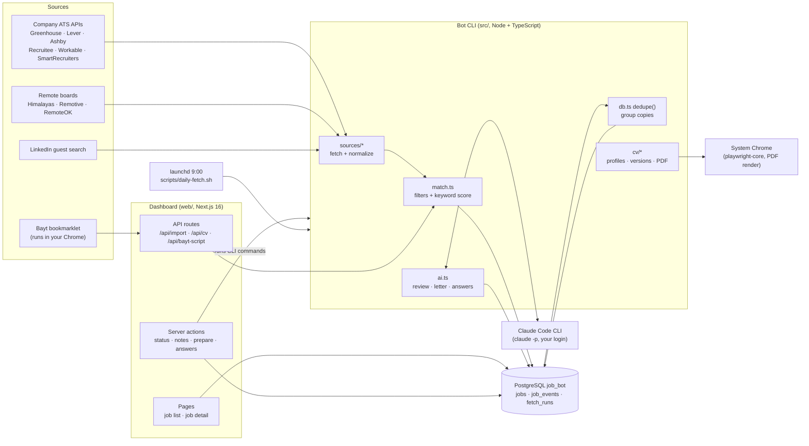

# job-bot

A personal job-search assistant that runs on your own Mac. It finds software engineering jobs in the **UAE, Saudi Arabia and the Netherlands** (onsite, with visa) and **remote jobs open to Pakistan**. It filters and scores them against your CV, prepares the right CV version, cover letter and form answers for each one, and tracks where you applied.

## Purpose

Job hunting across several countries means checking dozens of company career pages and job boards every day, reading each posting to see whether it fits (stack, language, visa, region lock), then tailoring a CV and cover letter. job-bot does the searching, filtering and preparation so you only spend time on jobs that fit.

**It never applies on your behalf.** The bot finds, scores and prepares. You review everything and submit applications yourself. Account creation, logins and CAPTCHAs are always done by you.

Design principles:

- **Local first.** Everything runs on your machine: a local PostgreSQL database, a local dashboard and the Claude Code CLI you are already signed in to. No paid APIs and no cloud server.
- **APIs over scraping.** Jobs come from public job-board APIs (Greenhouse, Lever, Ashby, ...) wherever possible. Requests are paced so no site blocks the bot.
- **Truthful CVs.** CV versions only re-order and re-frame what is in your master CV. They never add skills or claims (enforced by tests).

## Features

### Job discovery

- **Company career boards** (about 50 companies in `config.json` → `companies`) via the public APIs of Greenhouse, Lever, Ashby, Recruitee, Workable, SmartRecruiters and Workday.
- **Remote job boards:** Himalayas (only jobs open to Pakistan), Remotive and RemoteOK.
- **Workday career sites** (`*.myworkdayjobs.com`, used by many large UAE/Saudi employers): add a company with `"ats": "workday"` and `"token": "<tenant>/<wdN>/<site>"`, e.g. `acme/wd3/AcmeCareers` for `https://acme.wd3.myworkdayjobs.com/en-US/AcmeCareers`. Or pass that full URL to `bot discover`. Listings come from Workday's public JSON search (at most 500 per company); descriptions are only loaded for postings whose title, location (target country, remote or "N Locations") and age could pass the filters, at most 40 per company.
- **Arbeitnow** (free public API, mostly Germany): only Netherlands and remote postings are kept. On by default (`remote.boards`).
- **Adzuna** (official API, Netherlands index; Adzuna has no UAE or Saudi index): searches the LinkedIn keywords (or `adzuna.keywords`) in `adzuna.countries`, `adzuna.pagesPerSearch` pages of 50 each. It needs a free key you register yourself at developer.adzuna.com; put it in `.env` (see `.env.example`):

  ```
  ADZUNA_APP_ID=...
  ADZUNA_APP_KEY=...
  ```

  Without them Adzuna is skipped with one log line. Adzuna only returns a snippet of each description, so its keyword scores see less text.
- **LinkedIn** guest job search (no login, your account is never used). It covers onsite jobs in AE/SA/NL and remote jobs open to Pakistan. Requests are 1.2 s apart, and LinkedIn is skipped for the day on a 429.
- **Bayt** via a browser bookmarklet (`scripts/bayt-collect.js`), because Bayt blocks direct requests. You click it on bayt.com and it sends jobs to the dashboard's `/api/import`.
- **Chrome extension** (`extension/`, see [extension/README.md](extension/README.md)): "Send to job-bot" from any job page (Bayt, GulfTalent, NaukriGulf, company sites), and an "Apply helper" side panel with the prepared CV, letter and answers to copy. It never fills in or submits forms.
- **Manual add** of any job as JSON (`bot add`), e.g. from GulfTalent or a referral.
- **Company discovery** (`bot discover <names> --add`) tries a company name on the six ATS platforms that work by name (a full myworkdayjobs.com URL tries Workday) and adds it to the config if it has jobs in your target countries.
- **Daily automatic fetch** at 9:00 through a macOS launchd job, followed by AI review of new matches and a macOS notification.

### Filtering and scoring

Every posting is checked by `src/match.ts`. Jobs that fail a rule are kept with status `filtered` and a reason, so you can see why.

- **Location:** AE, SA and NL onsite, plus remote jobs that can be done from Pakistan. Remote jobs locked to the US, Canada, LATAM etc. are skipped. "EMEA" or no region gets a warning flag.
- **Role:** engineering titles only. Other stacks (Java, Go, Python, ...), mobile, QA and management roles are excluded.
- **Language:** postings that require fluent Dutch, Arabic or German are skipped. "Arabic is a plus" only adds a warning.
- **Visa:** UAE/Saudi employers provide visas. NL companies must be on the IND recognised-sponsor register (`bot sponsors:update` refreshes it). "No sponsorship" and "must have right to work" postings are skipped.
- **Age:** postings older than `maxAgeDays` (14) are skipped, and matching jobs expire automatically once they get older.
- **Keyword score:** a weighted match of the job's skills against yours, with a `minScore` threshold. It also suggests which CV version fits.
- **AI review:** the local Claude CLI (model `haiku`) reads each matching job together with your CV and returns a 0–100 score, a verdict (strong / good / stretch / poor), reasons, gaps and red flags (part-time, language, visa, region lock).
- **Instant alerts:** when the AI rates a job `strong`, `ai:score` (and so the daily fetch) shows a macOS notification right away: one per job, or one grouped notification for more than three. Each job alerts once (`alerted_at`). With `terminal-notifier` installed (Homebrew), clicking it opens the job in the dashboard. Turn it off with `config.json` → `ai.alertStrong: false`.
- **Salary:** a salary range in the title or description (AED, SAR, EUR, USD, GBP, PKR; "20k–25k", "up to", per month / per year / per hour, Dutch "bruto per maand") is stored with the job. Funding rounds, budgets, bonuses and years of experience are ignored, and an unclear amount is left out rather than guessed. Adzuna, Himalayas, RemoteOK and Lever give salary data of their own, which wins over the text. `rescore` fills it in for jobs already stored.
- **Duplicate grouping:** the same job found on several sites (company board, LinkedIn, Bayt, Himalayas) is shown once, with links to every copy.

### Application preparation

- **CV versions:** a default CV plus versions per stack cluster (`laravel`, `tall`, `laravel-vue`, `mern`, `pern`, `next-nest`, `backend-node`, `frontend-react`, `ai-fullstack`) and one-off custom CVs for a single job. Every PDF has the same filename (`abdulrehman_dar_resume.pdf`), and the folder name identifies the version. Versions are reused and only rebuilt (`v2`, `v3`, ...) when the master CV, profiles or template change.
- **Cover letters:** written by Claude (model `sonnet`) from the job description and your CV, using only true facts and making no promises about salary, notice period or start date. If AI fails, a template letter is used instead.
- **CV keyword check** (`bot ats <id>`, and on the job page): the job's skill keywords split into those the CV version shows near the top, those you have (in `cv/master.json`) but this version keeps further down, and real gaps that are not on your CV at all. It names the CV version that shows the most of them. Gaps are only listed, never suggested for the CV.
- **Form answers:** paste the questions from an application form and Claude drafts an answer for each one, using only your CV and `cv/applicant.json`. Personal decisions it cannot know (salary, notice period, start date) come back as `[FILL: ...]` and are highlighted. Each answer has a Copy button.
- **Interview prep:** for applied and interview jobs, Claude (model `sonnet`) writes likely technical questions with what to emphasise from your CV, behavioural questions with STAR stories built only from your CV, a short company brief from the posting alone (no web research, so unsure points are marked "verify before interview"), questions to ask them, and the job's key requirements mapped to your CV or marked as gaps. Everything has Copy buttons and a Regenerate button.

### Tracking

- Statuses: `new` → `prepared` → `applied` → `interview` → `offer` / `rejected`, plus `skipped`, `expired` and `filtered`.
- Dead-link check: `bot check:open` asks each ATS API whether a posting still exists (Greenhouse, Lever, Recruitee, SmartRecruiters and Workday per posting; Ashby and Workable via the board list) and opens the page for other boards, where a 404/410, "no longer accepting applications" text or a redirect to a careers page means closed. Closed `new`/`prepared` jobs become `expired`; jobs you applied to keep their status and only show "Posting closed". Network errors, 5xx and rate limits never expire a job, and a LinkedIn 429 stops LinkedIn checks for that run. `prepare` checks first and stops on a closed posting (`--force` skips the check). The daily fetch checks up to 100 jobs not checked in 3 days.
- Every status change is logged with an optional note (`job_events`), and every fetch is logged with counts and errors (`fetch_runs`).
- Free-text notes per job (recruiter name, contacts, follow-ups).

### Dashboard

```bash
npm run web          # http://localhost:3100
```

- Tabs per status, search, country filter, minimum score and "best match first" sorting (AI score first, keyword score as fallback).
- Salary on each card ("AED 20k–25k / month") and a "Min salary" filter in any of the six currencies, per month or year. It compares in euros per year with fixed, approximate rates (`web/lib/salary.ts`). Jobs without a salary stay visible unless "only with salary" is ticked. When `cv/applicant.json` has `expectedSalary` for the job's country (`AE`, `SA`, `NL`, `remote`), a lower salary gets a "below your expectation" hint; it never hides the job. A plain number there is in the country's currency, per month for AE/SA and per year otherwise; text such as `"AED 25,000 per month"` says it itself.
- Per job: open the posting, prepare CV + letter (with a CV-version picker), download the CV, AI review, and status buttons.
- Job page: "Check if still open" button, full description, CV keyword check, cover letter with Copy and Rewrite, form-answer helper, notes and status history.
- "Fetch new jobs" button and a "Add jobs from Bayt" page with the bookmarklet.

## How it works

### Architecture



The project has two parts that share one PostgreSQL database:

1. **The bot CLI** (`src/`) does all the real work: fetching, scoring, AI calls and CV rendering. Node 24+ runs the TypeScript directly, so there is no build step.
2. **The dashboard** (`web/`, Next.js) reads the database directly for display. For anything heavy (fetch, prepare, AI review, form answers, interview prep) its server actions queue a background task and return at once: they insert a row in `tasks` and start a detached `bot task:run <id>` (`web/lib/bot.ts` `spawnBot`, argument array, no shell, output in `data/logs/tasks.log`). That worker claims the row, runs the normal CLI command and stores the result, so the CLI and the dashboard always behave the same. The page shows "Working…" while a task runs, polls `/api/tasks` and refreshes when it finishes; failures stay on the page with their error until dismissed. Only one fetch, and one task per kind and job, runs at a time, and a task whose worker died is failed so it never blocks new ones: at once when its worker pid no longer exists, otherwise after its timeout (Mac slept or restarted). Finished tasks are deleted after 30 days (`src/tasks.ts`).

### A job's journey

1. **Fetch.** `bot fetch` loads every source, four at a time. Each adapter in `src/sources/` turns the API response into a common `RawJob` (id, company, title, location, url, description, posted date). Requests use a shared paced `sleep` (`src/sources/http.ts`).
2. **Score.** Every job goes through `scoreJob()` in `src/match.ts`. It detects the country, applies the filters, computes the keyword score and picks a CV cluster. The result is upserted into `jobs` with status `new` or `filtered` (+ reason).
3. **Group.** `dedupe()` links copies of the same job (normalized company + title + country) to one primary row, preferring the company's own site or the copy you already worked on.
4. **AI review.** `bot ai:score` sends each new match plus your CV to `claude -p` with a JSON schema and stores the score, verdict, reasons, gaps and flags.
5. **Prepare.** `bot prepare <id>` picks the CV version (default, or `--cv <cluster>`), renders the PDF if that version does not exist yet, writes the cover letter with Claude, and sets the status to `prepared`.
6. **Answer.** `bot answer <id>` drafts application-form answers and stores them on the job.
7. **Apply (you).** You open the posting, upload the CV, paste the letter and answers, submit, then mark the job `applied`.

### CV pipeline

```
cv/master.json                       your CV data (the only file you edit)
src/cv/profiles.ts                   per-cluster framing: headline, summary, skill/bullet order
src/cv/versions.ts                   builds and reuses versions, bumps v2/v3 on change
src/cv/render.ts                     HTML template → PDF via system Chrome (playwright-core)

cv/original/AbdulRehmanDarResume.pdf original, never changes
cv/default/abdulrehman_dar_resume.pdf
cv/versions/<cluster>-v<N>/abdulrehman_dar_resume.pdf
cv/versions/custom-<company-role>/abdulrehman_dar_resume.pdf
```

`config.json` → `"autoCvVersions": false` means every job gets the default CV unless you pick a version. Edit `cv/master.json`, then run `bot cv:default` (default CV) or `bot cv:build` (all versions).

### AI

All AI features call the Claude Code CLI you are signed in to (`claude -p`) with a JSON output schema, so there is no API key and usage comes from your Claude plan. Settings live in `config.json` → `ai`.

| Feature        | Model    | Time per job | Used by                         |
| -------------- | -------- | ------------ | ------------------------------- |
| Fit review     | `haiku`  | ~10 s        | `ai:score`, daily fetch, button |
| Cover letter   | `sonnet` | ~15–30 s     | `prepare`, "Rewrite letter"     |
| Form answers   | `sonnet` | ~15 s        | `answer`, "Draft answers"       |
| Interview prep | `sonnet` | ~30–60 s     | `prep`, "Prepare for interview" |

The prompts only allow facts from `cv/master.json` and `cv/applicant.json`. Fill in `cv/applicant.json` (copy it from `cv/applicant.example.json`) with your notice period, expected salary per country, etc., so form answers can use them.

### Database

Every CLI start applies the numbered SQL files in `src/migrations/` that the database has not run yet (recorded in `schema_migrations`), so there is no migration command. To change the schema, add the next `NNN_name.sql` file; never edit one that is already committed (see `src/migrate.ts`).

- `jobs`: one row per posting. It holds the score, matched/missing skills, visa note, flags, status, filter reason, CV version, cover letter, AI review, form answers, interview prep, alert time, notes and `duplicate_of`.
- `job_events`: every status change with a note.
- `fetch_runs`: per fetch, how many postings were checked, how many were new and which sources failed.

Connection: `postgres://postgres@127.0.0.1:5432/job_bot`, set in `.env` and `web/.env.local`. PostgreSQL runs through DBngin.

## Setup

Requirements: macOS, Node 24+, PostgreSQL (DBngin), Google Chrome and the Claude Code CLI (signed in).

```bash
npm install && npm --prefix web install
cp cv/applicant.example.json cv/applicant.json   # then fill it in
npm run bot -- sponsors:update                  # IND sponsor register (monthly)
npm run bot -- fetch
npm run web
```

## CLI reference

```bash
npm run bot -- fetch [--company <name>]       # fetch all sources (or one)
npm run bot -- rescore                        # re-apply filters after editing config.json, no downloads
npm run bot -- list [--status new] [--country NL] [--min 60]
npm run bot -- show <id> [--full]
npm run bot -- ai:score [--id <id>]           # AI fit review
npm run bot -- prepare <id> [--cv laravel] [--template] [--force]
npm run bot -- check:open [<id>...] [--status new,prepared] [--limit N]  # mark closed postings expired
npm run bot -- answer <id> [--file q.txt] [--clear]
npm run bot -- prep <id>                      # AI interview prep (questions, STAR stories, brief, gaps)
npm run bot -- custom <id> --overrides o.json # one-off CV for a single job
npm run bot -- mark <id> applied|interview|offer|rejected|skipped|expired ["note"] [--reason stack|seniority|salary|location|company|language|other]
npm run bot -- contacts <id>                  # a job's contacts, plus people you know at the same company
npm run bot -- contact:add <id> --name "Jane" [--role recruiter] [--email x] [--linkedin https://...] [--referral "to ask"]
npm run bot -- add [--file job.json]          # add a job manually (JSON or stdin)
npm run bot -- discover <company...> [--add]
npm run bot -- cv:default | cv:build [cluster...] | versions
npm run bot -- ats <id> [--cv next-nest] [--json] # CV keyword check: shown, hidden but true, missing
npm run bot -- sponsors:update | stats | dedupe
npm run bot -- settings:check|settings:save --kind config|applicant [--file x.json]  # validate (and save) settings, JSON result
```

`add` JSON format:

```json
{
  "source": "bayt",
  "company": "X",
  "title": "Senior Laravel Developer",
  "location": "Dubai, UAE",
  "url": "https://...",
  "description": "full job text"
}
```

### Daily fetch

The launchd job `~/Library/LaunchAgents/com.abdulrehman.job-bot.fetch.plist` runs `scripts/daily-fetch.sh` at 9:00 (or on wake). It logs to `data/fetch.log`. The project lives in `~/job-bot`, not on the Desktop, because macOS does not let background jobs read the Desktop.

Run it now:

```bash
launchctl kickstart gui/$(id -u)/com.abdulrehman.job-bot.fetch
```

Turn it off:

```bash
launchctl bootout gui/$(id -u)/com.abdulrehman.job-bot.fetch
```

## Configuration (`config.json`)

| Key                                          | What it controls                                               |
| -------------------------------------------- | -------------------------------------------------------------- |
| `countries`                                  | Target countries: location regex and visa rule per country     |
| `companies`                                  | Company boards to fetch (`ats` + `token`)                      |
| `roleInclude`/`roleExclude`                  | Title rules                                                    |
| `minScore`, `maxAgeDays`                     | Keyword-score threshold (45) and maximum posting age (14 days) |
| `remote`                                     | Remote boards and the allow/deny/flag region rules             |
| `linkedin`                                   | Keywords, locations, `remoteFrom`, pages per search            |
| `ai`                                         | Claude path, models, `maxScorePerRun`, concurrency             |
| `cvFileName`, `autoCvVersions`, `chromePath` | CV output settings                                             |

Both files are validated on load, so a typo stops the bot with the file and field name. Set `JOB_BOT_CONFIG` / `JOB_BOT_APPLICANT` to use other files.

After changing filters, run `npm run bot -- rescore`.

## Project structure

```
src/
  cli.ts            command entry point: flags, command registry, dedupe after changes
  commands/         one file per command (or small group of related commands)
  config.ts         loads config.json
  settings.ts       zod schemas for config.json and cv/applicant.json
  types.ts          row types shared with the dashboard
  match.ts          filters, keyword score, CV cluster
  salary.ts         salary range extraction
  ats.ts            CV keyword check (shown / hidden but true / missing)
  db.ts             Postgres access, upsert, status changes, dedupe
  migrate.ts        migration runner (applied on start)
  migrations/       numbered schema files (001_baseline.sql, ...)
  ai.ts             Claude CLI calls: review, letter, form answers
  cover.ts          template cover letter
  sponsors.ts       IND recognised-sponsor register
  discover.ts       find a company's ATS board
  sources/          ATS adapters, remote boards, LinkedIn, paced HTTP
  cv/               profiles, versioning, PDF rendering
web/
  app/              pages, server actions, API routes
  components/       UI and client components
  lib/              DB queries and the CLI runner
scripts/            daily fetch, Bayt bookmarklet
extension/          Chrome extension: send a job, apply helper side panel
tests/              backend tests (node:test)
web/tests/          dashboard tests (vitest)
```

## Tests

```bash
npm test             # backend: matching, sources, dedupe, CV, AI, DB, CLI (node:test)
npm run test:web     # dashboard: components, DB queries, API routes, server actions (vitest)
npm run test:all     # both
npm run typecheck    # tsc for the bot (src/, tests/) and the dashboard (web/)
npm run lint         # Biome lint + format check; npm run format fixes it
```

- Tests use separate databases: `job_bot_test_bot` (backend) and `job_bot_test` (dashboard). They never touch the real `job_bot`.
- Job-site requests are mocked, and a fake script (`tests/fixtures/fake-claude.mjs`) stands in for Claude, so tests run offline and use none of your Claude plan.
- Every new feature or change ships with its tests (see `CLAUDE.md`).
- `npm install` points git at `.githooks/`, so each commit runs Biome on the staged files. GitHub Actions runs lint, typecheck and both suites on every push.

## Tech stack

- Node 24+ running TypeScript directly (ESM, no build step)
- PostgreSQL via `pg`, shared by the bot and the dashboard
- Next.js 16 + Tailwind (`web/`)
- `playwright-core` with system Chrome for CV PDFs
- Claude Code CLI for AI features
- node:test and Vitest + Testing Library for tests

## Roadmap

See [ROADMAP.md](ROADMAP.md) for what is done and what is still open.
