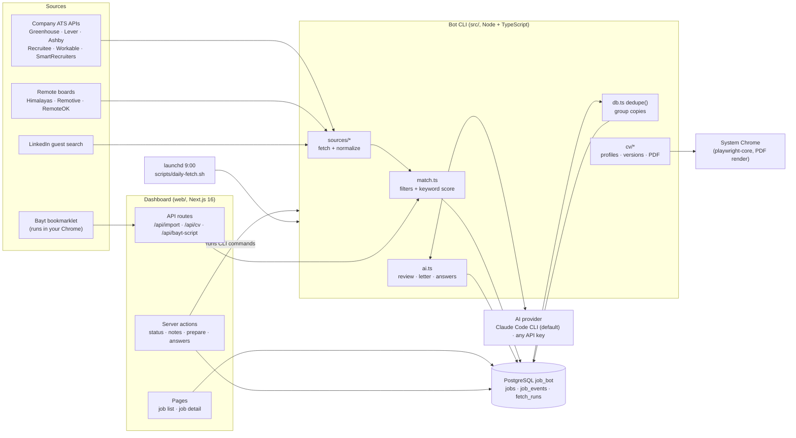

# job-bot

A personal job-search assistant that runs on your own Mac. It finds software engineering jobs in the **countries you target** (onsite, with or without a visa) and **remote jobs open to the country you live in**. It filters and scores them against your CV, prepares the right CV version, cover letter and form answers for each one, and tracks where you applied.

Everything personal lives in two files you fill in yourself, `cv/master.json` (your CV) and `cv/applicant.json` (your profile), plus the target markets in `config.json`. `npm run bot -- setup` asks for all of it: see [Getting started for a new user](#getting-started-for-a-new-user). The `config.json` in the repository is the original author's (UAE, Saudi Arabia and the Netherlands with visa sponsorship, remote from Pakistan); the examples below use it.

## Purpose

Job hunting across several countries means checking dozens of company career pages and job boards every day, reading each posting to see whether it fits (stack, language, visa, region lock), then tailoring a CV and cover letter. job-bot does the searching, filtering and preparation so you only spend time on jobs that fit.

**It never applies on your behalf.** The bot finds, scores and prepares. You review everything and submit applications yourself. Account creation, logins and CAPTCHAs are always done by you.

Design principles:

- **Local first.** Everything runs on your machine: a local PostgreSQL database, a local dashboard and, by default, the Claude Code CLI you are already signed in to. No cloud server. Without Claude, the AI can run on any OpenAI-compatible API (OpenAI, Anthropic, Gemini, Groq, DeepSeek, ...) with one API key of your own instead (see [AI](#ai)).
- **APIs over scraping.** Jobs come from public job-board APIs (Greenhouse, Lever, Ashby, ...) wherever possible. Requests are paced so no site blocks the bot.
- **Truthful CVs.** CV versions only re-order and re-frame what is in your master CV. They never add skills or claims (enforced by tests).

## Features

### Job discovery

- **Company career boards** (about 50 companies in `config.json` → `companies`) via the public APIs of Greenhouse, Lever, Ashby, Recruitee, Workable, SmartRecruiters and Workday.
- **Remote job boards:** Himalayas (only jobs open to your remote-from country, `remote.fromCode`), Remotive and RemoteOK.
- **Workday career sites** (`*.myworkdayjobs.com`, used by many large UAE/Saudi employers): add a company with `"ats": "workday"` and `"token": "<tenant>/<wdN>/<site>"`, e.g. `acme/wd3/AcmeCareers` for `https://acme.wd3.myworkdayjobs.com/en-US/AcmeCareers`. Or pass that full URL to `bot discover`. Listings come from Workday's public JSON search (at most 500 per company); descriptions are only loaded for postings whose title, location (target country, remote or "N Locations") and age could pass the filters, at most 40 per company.
- **Arbeitnow** (free public API, mostly Germany): only Netherlands and remote postings are kept. On by default (`remote.boards`).
- **Adzuna** (official API, Netherlands index; Adzuna has no UAE or Saudi index): searches the LinkedIn keywords (or `adzuna.keywords`) in `adzuna.countries`, `adzuna.pagesPerSearch` pages of 50 each. It needs a free key you register yourself at developer.adzuna.com; put it in `.env` (see `.env.example`):

  ```
  ADZUNA_APP_ID=...
  ADZUNA_APP_KEY=...
  ```

  Without them Adzuna is skipped with one log line. Adzuna only returns a snippet of each description, so its keyword scores see less text.
- **LinkedIn** guest job search (no login, your account is never used). It covers onsite jobs in `linkedin.locations` and remote jobs searched from `linkedin.remoteFrom`. Requests are 1.2 s apart, and LinkedIn is skipped for the day on a 429.
- **Bayt** via a browser bookmarklet (`scripts/bayt-collect.js`), because Bayt blocks direct requests. You click it on bayt.com and it sends jobs to the dashboard's `/api/import`.
- **Chrome extension** (`extension/`, see [extension/README.md](extension/README.md)): "Send to job-bot" from any job page (Bayt, GulfTalent, NaukriGulf, company sites), and an "Apply helper" side panel with the prepared CV, letter and answers to copy. **Fill this form** types your name and contact details, the cover letter, drafted answers and the CV PDF into the form's empty fields (outlined in orange). It never overwrites what you typed, never fills answers that need your input, and never clicks a button or submits: you check the form and submit it yourself.
- **Manual add** of any job as JSON (`bot add`), e.g. from GulfTalent or a referral.
- **Company discovery** (`bot discover <names> --add`) tries a company name on the six ATS platforms that work by name (a full myworkdayjobs.com URL tries Workday) and adds it to the config if it has jobs in your target countries.
- **Daily automatic fetch** at 9:00 through a macOS launchd job, followed by AI review of new matches and a macOS notification.

### Filtering and scoring

Every posting is checked by `src/match.ts`. Jobs that fail a rule are kept with status `filtered` and a reason, so you can see why.

- **Location:** onsite jobs in the `config.json` → `countries`, plus remote jobs that can be done from your country (`remote.from`; `remote.allow` / `remote.deny` list the regions that include or exclude it). Remote jobs locked to other regions are skipped. "EMEA" or no region gets a warning flag.
- **Role:** engineering titles only. Other stacks (Java, Go, Python, ...), mobile, QA and management roles are excluded.
- **Language:** postings that require fluent Dutch, Arabic, German or French are skipped, unless your profile lists that language. "Arabic is a plus" only adds a warning.
- **Visa:** per target country, `needsVisa` says whether you need one (missing = yes; the country you live in never does). Where you do, `visa: "employer"` means the employer provides it, and `"ind-register"` (Netherlands) means the company must be on the IND recognised-sponsor register (`bot sponsors:update` refreshes it); "No sponsorship" and "must have right to work" postings are skipped. Where you do not, those rules are skipped.
- **Visa label on every job:** only the posting itself counts as an offer. Each job shows one of four labels:
  - **✓ Visa/relocation offered:** the posting says so.
  - **✓ No visa needed:** a remote job, or a country you may already work in.
  - **? Company can sponsor, posting does not say:** the company is an IND recognised sponsor.
  - **? Visa/relocation not mentioned:** the posting is silent. Many Gulf employers sponsor the work visa anyway, but some only hire people already in the country.

  Hover a label for the full note. The **Visa/relocation offered (or not needed)** filter on the job list shows only the first two kinds. The AI location check also marks a silent onsite posting `unclear`, not `yes`.
- **Age:** postings older than `maxAgeDays` (14) are skipped, and matching jobs expire automatically once they get older.
- **Keyword score:** a weighted match of the job's skills against yours (a skill counts as yours when `cv/master.json` lists it), with a `minScore` threshold. It also suggests which CV version fits.
- **AI review:** the AI (by default the local Claude CLI with model `haiku`; see [AI](#ai) for an API key instead) reads each matching job together with your CV and returns a 0–100 score, a verdict (strong / good / stretch / poor), reasons, gaps and red flags (part-time, language, visa, region lock).
- **Location check from the whole description:** the same review decides whether you can take the job from where you live (`yes` / `no` / `unclear`), reading the full description rather than only the location field: "US only", "must reside in…", "authorized to work in X without sponsorship", required time zones, or a description that names another country ("work remotely from Slovenia" on a Saudi listing). A `no` moves a matching job to **Filtered out** with the quoted reason (`location (AI): …`), and it stays there when jobs are re-scored; jobs you already acted on keep their status. An `unclear` adds a "Location unclear" flag to check. Himalayas jobs limited to time zones far from GMT+5 are filtered by the keyword rules already.
- **Instant alerts:** when the AI rates a job `strong`, `ai:score` (and so the daily fetch) shows a macOS notification right away: one per job, or one grouped notification for more than three. Each job alerts once (`alerted_at`). With `terminal-notifier` installed (Homebrew), clicking it opens the job in the dashboard. Turn it off with `config.json` → `ai.alertStrong: false`.
- **Salary:** a salary range in the title or description (AED, SAR, EUR, USD, GBP, PKR; "20k–25k", "up to", per month / per year / per hour, Dutch "bruto per maand") is stored with the job. Funding rounds, budgets, bonuses and years of experience are ignored, and an unclear amount is left out rather than guessed. Adzuna, Himalayas, RemoteOK and Lever give salary data of their own, which wins over the text. `rescore` fills it in for jobs already stored.
- **Duplicate grouping:** the same job found on several sites (company board, LinkedIn, Bayt, Himalayas) is shown once, with links to every copy.

### Application preparation

- **CV versions:** a default CV plus versions per stack cluster (`laravel`, `tall`, `laravel-vue`, `mern`, `pern`, `next-nest`, `backend-node`, `frontend-react`, `ai-fullstack`) and one-off custom CVs for a single job. Every PDF has the same filename (`config.json` → `cvFileName`), and the folder name identifies the version. Versions are reused and only rebuilt (`v2`, `v3`, ...) when the master CV, profiles or template change.
- **Cover letters:** written by the AI (letter model) from the job description and your CV, using only true facts and making no promises about salary, notice period or start date. They are signed with the name and contact in your profile. If AI fails, a template letter is used instead, built from your profile: its `coverLetter` sentences (introduction, a pitch per CV cluster, how you work, remote experience), where you live and your visa need. To change a letter, tell the AI what should change (`letter <id> --feedback "shorter"`, e.g. "less formal" or "more about one project"): it rewrites the current letter with the same rules, and if the feedback asks for something your CV does not show, it leaves it out and says so in a short note. Or edit the letter by hand on the job page.
- **CV summary for a job:** the AI (letter model) rewrites the summary at the top of your CV for one job, from your CV and the job description: 3–4 sentences, 50–90 words, in the voice of your current summary, with only facts from your CV (no new skills, years or numbers, no promises). `summary <id>` writes it, `summary <id> --feedback "…"` rewrites it like a letter, and `cv:tailor <id>` builds a one-off CV version with it (in a new `custom-<company-role>-v<N>` folder every time, so a CV you already sent is never overwritten) and makes it the job's CV.
- **CV templates:** every CV can be rendered in one of three ATS-safe designs (one text column, real text, standard section names, no images or tables): **classic** (the original design, unchanged), **modern** (a teal name banner and accent colour, skills as short text lines) and **compact** (smaller font and tighter spacing, to fit more on one page). `config.json` → `cvTemplate` sets the default (missing = classic), and each job can use its own: `cv:template <id> <template>` (or **Apply template** on the job page) re-renders the job's CV as a new version, so a CV you may already have sent is never overwritten. `prepare`, `cv:tailor` and `custom` use the job's template. `cv:templates` lists them and `cv:preview <template> [--pdf]` shows your master CV in one.
- **Feedback on the generated CV:** `cv:feedback <id> --feedback "…"` (at most 1000 characters; "summary too generic", "put Laravel experience first", "too long, fit on one page", "skills order wrong") has the AI (letter model) revise the job's CV from the job description, your master CV and the job's current CV. It may only reorder, re-frame, shorten or select what `cv/master.json` has: the title and summary wording, the order and selection of skill groups, skills, bullets and projects. The reply is then checked in code (`src/cv/feedback.ts`): every employer, bullet, skill group, skill and project must match the master CV, a new title or summary may not name a skill or number the master does not have, and employers are never dropped. Anything else is left out and listed under the AI's note. The result is a new one-off version in the job's template, made the job's CV. `cv:review <id>` ("Suggest improvements") stores a short, honest AI review of the CV against the job (what is weak or missing, what to put first) that you can turn into feedback.
- **CV keyword check** (`bot ats <id>`, and on the job page): the job's skill keywords split into those the CV version shows near the top, those you have (in `cv/master.json`) but this version keeps further down, and real gaps that are not on your CV at all. It names the CV version that shows the most of them. Gaps are only listed, never suggested for the CV.
- **Form answers:** paste the questions from an application form and the AI drafts an answer for each one, using only your CV and `cv/applicant.json`. Personal decisions it cannot know (salary, notice period, start date) come back as `[FILL: ...]` and are highlighted. Each answer has a Copy button.
- **Interview prep:** for applied and interview jobs, the AI (letter model) writes likely technical questions with what to emphasise from your CV, behavioural questions with STAR stories built only from your CV, a short company brief from the posting alone (no web research, so unsure points are marked "verify before interview"), questions to ask them, and the job's key requirements mapped to your CV or marked as gaps. Everything has Copy buttons and a Regenerate button.
- **Follow-up reminders:** an `applied` job with no news for 7 days shows a "Follow up · N days" badge and appears in the **Needs follow-up** tab. On the job page, "Draft follow-up" has the AI write a short message (addressed to the job's recruiter or hiring manager contact if you added one, CV facts only), with a template fallback. You send it yourself and click "I sent a follow-up"; the reminder then waits another 7 days, and stops after 2 follow-ups. CLI: `follow-ups`, `follow-up <id>`, `followed-up <id>`.

### Tracking

- Statuses: `new` → `prepared` → `applied` → `interview` → `offer` / `rejected`, plus `skipped`, `expired` and `filtered`.
- Dead-link check: `bot check:open` asks each ATS API whether a posting still exists (Greenhouse, Lever, Recruitee, SmartRecruiters and Workday per posting; Ashby and Workable via the board list) and opens the page for other boards, where a 404/410, "no longer accepting applications" text or a redirect to a careers page means closed. Closed `new`/`prepared` jobs become `expired`; jobs you applied to keep their status and only show "Posting closed". Network errors, 5xx and rate limits never expire a job, and a LinkedIn 429 stops LinkedIn checks for that run. `prepare` checks first and stops on a closed posting (`--force` skips the check). The daily fetch checks up to 100 jobs not checked in 3 days.
- Every status change is logged with an optional note (`job_events`), and every fetch is logged with counts and errors (`fetch_runs`).
- Free-text notes per job (recruiter name, contacts, follow-ups).

### Dashboard

```bash
npm run web          # http://localhost:3100
```

- It is for this Mac only: it listens on 127.0.0.1, not on your Wi-Fi, and `web/proxy.ts` refuses any request whose Host is not localhost (so a web page cannot reach it through DNS rebinding). There is no login, so do not expose it.
- Tabs per status, search, country filter, minimum score and "best match first" sorting (AI score first, keyword score as fallback).
- Salary on each card ("AED 20k–25k / month") and a "Min salary" filter in any of the six currencies, per month or year. It compares in euros per year with fixed, approximate rates (`web/lib/salary.ts`). Jobs without a salary stay visible unless "only with salary" is ticked. When `cv/applicant.json` has `expectedSalary` for the job's country (`AE`, `SA`, `NL`, `remote`), a lower salary gets a "below your expectation" hint; it never hides the job. A plain number there is in the country's currency, per month for AE/SA and per year otherwise; text such as `"AED 25,000 per month"` says it itself.
- The list shows 25 jobs per page (10, 50 or 100 with the "per page" filter), with page links above and below it. The page links keep the tab, filters and sort; changing the tab or filters goes back to page 1.
- Per job: open the posting, **Prepare CV** (picks or builds the CV version), **Download CV**, AI review, and status buttons.
- Job page: "Check if still open" button, full description, CV keyword check, cover letter, form-answer helper, notes and status history. The cover letter is never written automatically: **Write letter** writes it (AI from the description, else the template), **Rewrite letter** writes a new one, **Copy** copies it, and **Download PDF** downloads it as a one-page PDF in the CV's style, with your name and contact as the header (`bot letter:pdf <id>`, saved as `cover-letter.pdf` in the job's `applications/` folder). Under the letter, **What should change?** with **Rewrite with feedback** has the AI rewrite it (`letter <id> --feedback`), and **Edit** lets you change it yourself and **Save** it with no AI (the label then says "edited by you").
- Job page, **CV for this job**: the CV version and its template, a template select with **Apply template** (a background task; previews of each template open in a new tab), **Download CV**, **What should change in this CV?** with **Improve CV with feedback** (`cv:feedback`), and **Suggest improvements** (`cv:review`) whose suggestions **Use as feedback** copies into the box. When a CV was revised with feedback, what was left out because your master CV does not have it is listed there. `GET /api/cv/preview/<template>` shows your master CV in a template (HTML, or `?pdf` for a PDF). The Settings page has the default **CV template**.
- Job page, **CV summary for this job** (next to the cover letter): **Write summary** has the AI write a CV summary for the job, then **Rewrite summary**, **Copy** and **Use in my CV for this job**, which builds a one-off CV with it (`cv:tailor`) so **Download CV** serves that one. It has the same **What should change?** and **Edit** as the letter. While the AI writes or the CV is built, a "Writing summary…" / "Building CV with this summary…" note replaces the buttons.
- "Fetch new jobs" button and a "Add jobs from Bayt" page with the bookmarklet.

## How it works

### Architecture



The project has two parts that share one PostgreSQL database:

1. **The bot CLI** (`src/`) does all the real work: fetching, scoring, AI calls and CV rendering. Node 24+ runs the TypeScript directly, so there is no build step.
2. **The dashboard** (`web/`, Next.js) reads the database directly for display. For anything heavy (fetch, prepare, AI review, form answers, interview prep, follow-up drafts) its server actions queue a background task and return at once: they insert a row in `tasks` and start a detached `bot task:run <id>` (`web/lib/bot.ts` `spawnBot`, argument array, no shell, output in `data/logs/tasks.log`). That worker claims the row, runs the normal CLI command and stores the result, so the CLI and the dashboard always behave the same. The page shows "Working…" while a task runs, polls `/api/tasks` and refreshes when it finishes; failures stay on the page with their error until dismissed. Only one fetch, and one task per kind and job, runs at a time, and a task whose worker died is failed so it never blocks new ones: at once when its worker pid no longer exists, otherwise after its timeout (Mac slept or restarted). Finished tasks are deleted after 30 days (`src/tasks.ts`).

### A job's journey

1. **Fetch.** `bot fetch` loads every source, four at a time. Each adapter in `src/sources/` turns the API response into a common `RawJob` (id, company, title, location, url, description, posted date). Requests use a shared paced `sleep` (`src/sources/http.ts`).
2. **Score.** Every job goes through `scoreJob()` in `src/match.ts`. It detects the country, applies the filters, computes the keyword score and picks a CV cluster. The result is upserted into `jobs` with status `new` or `filtered` (+ reason).
3. **Group.** `dedupe()` links copies of the same job (normalized company + title + country) to one primary row, preferring the company's own site or the copy you already worked on.
4. **AI review.** `bot ai:score` sends each new match plus your CV to the AI provider with a JSON schema and stores the score, verdict, reasons, gaps, flags and the location check (a `no` moves the job to `filtered`). `ai:score --all` reviews every matching job again.
5. **Prepare.** `bot prepare <id>` picks the CV version (default, or `--cv <cluster>`), renders the PDF if that version does not exist yet, and sets the status to `prepared`. It writes no cover letter: `bot letter <id>` ("Write letter" on the job page) does that on request, or `prepare --letter` for both at once.
6. **Answer.** `bot answer <id>` drafts application-form answers and stores them on the job.
7. **Apply (you).** You open the posting, upload the CV, paste the letter and answers, submit, then mark the job `applied`.

### CV pipeline

```
cv/master.json                       your CV data (the only file you edit)
src/cv/profiles.ts                   per-cluster framing: headline, summary, skill/bullet order
src/cv/versions.ts                   builds and reuses versions, bumps v2/v3 on change
src/cv/render.ts                     HTML → PDF via system Chrome (playwright-core)
src/cv/templates/                    the CV designs: classic.ts, modern.ts, compact.ts, index.ts (list and names)
src/cv/feedback.ts                   keeps a CV revised with feedback to master CV content

cv/original/<your original CV>.pdf  optional, never changes
cv/default/<cvFileName>
cv/versions/<cluster>-v<N>/<cvFileName>
cv/versions/<cluster>-<template>-v<N>/<cvFileName>   the same in another template (modern, compact); cluster may be "default"
cv/versions/custom-<company-role>-v<N>/<cvFileName>   one-off CV for one job (custom, cv:tailor, cv:feedback, cv:template), new N per run
```

Each version folder has `cv.json` (the data it was rendered from) and `meta.json` (cluster, template, master hash, the job for one-off versions, and for a CV revised with feedback what was left out). Versions made before templates existed have no template and are classic.

`cvFileName` is set in `config.json` (e.g. `jane_doe_resume.pdf`). The per-cluster framings in `src/cv/profiles.ts` (headline and summary per stack) are written for the original author's CV; with your own CV, keep `autoCvVersions: false` and send the default CV until you have rewritten them for yourself (`tests/cv.test.ts` checks a framing never claims more than `cv/master.json`).

`config.json` → `"autoCvVersions": false` means every job gets the default CV unless you pick a version. Edit `cv/master.json`, then run `bot cv:default` (default CV) or `bot cv:build` (all versions).

### AI

Every AI feature asks for JSON that matches an output schema. `config.json` → `ai.provider` picks who answers:

| `ai.provider`          | How it runs                                                             | Key                    | Cost                             |
| ---------------------- | ----------------------------------------------------------------------- | ---------------------- | -------------------------------- |
| `claude-cli` (default) | The Claude Code CLI you are signed in to (`claude -p`), `ai.claudePath` | none                   | your Claude plan                 |
| `api`                  | Any OpenAI-compatible chat API (`POST <base URL>/chat/completions`)     | `AI_API_KEY` in `.env` | paid per token, by that provider |

With `api`, add one key and it is used: the provider comes from `ai.api.preset`, else from `AI_BASE_URL` (a custom endpoint), else from the key's prefix.

| Preset       | Key prefix (auto-detect) | Base URL                                                  | Score model                        | Letter model                   | JSON                 |
| ------------ | ------------------------ | --------------------------------------------------------- | ---------------------------------- | ------------------------------ | -------------------- |
| `openai`     | other `sk-`              | `https://api.openai.com/v1`                               | `gpt-4o-mini`                      | `gpt-4o`                       | JSON schema          |
| `anthropic`  | `sk-ant-`                | `https://api.anthropic.com/v1`                            | `claude-haiku-5-5`                 | `claude-sonnet-5-5`            | schema in the prompt |
| `gemini`     | `AIza`                   | `https://generativelanguage.googleapis.com/v1beta/openai` | `gemini-2.5-flash`                 | `gemini-2.5-pro`               | JSON schema          |
| `groq`       | `gsk_`                   | `https://api.groq.com/openai/v1`                          | `llama-3.1-8b-instant`             | `llama-3.3-70b-versatile`      | JSON mode + schema   |
| `openrouter` | `sk-or-`                 | `https://openrouter.ai/api/v1`                            | `openai/gpt-4o-mini`               | `openai/gpt-4o`                | JSON mode + schema   |
| `deepseek`   | set the preset           | `https://api.deepseek.com`                                | `deepseek-chat`                    | `deepseek-chat`                | JSON mode + schema   |
| `mistral`    | set the preset           | `https://api.mistral.ai/v1`                               | `mistral-small-latest`             | `mistral-large-latest`         | JSON schema          |
| `together`   | set the preset           | `https://api.together.xyz/v1`                             | `Meta-Llama-3.1-8B-Instruct-Turbo` | `Llama-3.3-70B-Instruct-Turbo` | JSON mode + schema   |
| `ollama`     | no key needed            | `http://localhost:11434/v1`                               | `llama3.1`                         | `llama3.1`                     | JSON mode + schema   |
| `custom`     | any                      | `AI_BASE_URL` or `ai.api.baseUrl`                         | `ai.api.scoreModel`                | `ai.api.letterModel`           | JSON mode + schema   |

**DeepSeek keys also start with `sk-`**, so they look like OpenAI keys: set `"preset": "deepseek"` (or `AI_BASE_URL`). An explicit preset or `AI_BASE_URL` always wins over the prefix.

Each feature uses either the score model (fast) or the letter model (better writer):

| Feature        | Model  | Claude CLI | API (preset default) | Used by                                             |
| -------------- | ------ | ---------- | -------------------- | --------------------------------------------------- |
| Fit review     | score  | `haiku`    | score model          | `ai:score`, daily fetch, button                     |
| Cover letter   | letter | `sonnet`   | letter model         | `letter`, "Write letter", "Rewrite with feedback"   |
| CV summary     | letter | `sonnet`   | letter model         | `summary`, "Write summary", "Rewrite with feedback" |
| CV feedback    | letter | `sonnet`   | letter model         | `cv:feedback`, "Improve CV with feedback"           |
| CV review      | letter | `sonnet`   | letter model         | `cv:review`, "Suggest improvements"                 |
| Form answers   | letter | `sonnet`   | letter model         | `answer`, "Draft answers"                           |
| Interview prep | letter | `sonnet`   | letter model         | `prep`, "Prepare for interview"                     |
| Follow-up      | letter | `sonnet`   | letter model         | `follow-up`, "Draft follow-up"                      |

- **Claude CLI models** are `ai.scoreModel` / `ai.letterModel`. **API models** are `ai.api.scoreModel` / `ai.api.letterModel`; missing ones use the preset's defaults above. `ai.api.baseUrl` (or `AI_BASE_URL`) points at a proxy or another compatible endpoint, and `ai.api.responseFormat` (`json_schema`, `json_object`, `text`) overrides how JSON is asked for. A fit review takes about 10 s and a letter 15–60 s with any provider.
- **The key** lives only in `.env` in the job-bot folder (see `.env.example`), never in `config.json`, and is never logged or shown; it is only sent to that provider's base URL. A missing key stops before any request, a rejected key (401/403) stops at once with a message naming `AI_API_KEY` and the provider, and a reply that is not the JSON asked for is asked for once more.
- **Older settings still work:** `ai.provider` `"openai"` / `"deepseek"` (with their `ai.openai` / `ai.deepseek` sections) are read as `api` with that preset, and `OPENAI_API_KEY` / `DEEPSEEK_API_KEY` are read when `AI_API_KEY` is not set.
- Switch on the dashboard's Settings page ("AI provider": Claude CLI or API key, then the preset and models, with a line saying whether `AI_API_KEY` is set and whose key it looks like) or in `npm run bot -- setup`. Neither asks for the key itself.

```bash
# .env, with "ai": { "provider": "api", ... } in config.json
AI_API_KEY=sk-ant-...
```

The prompts only allow facts from `cv/master.json` and `cv/applicant.json`, and describe you from your profile (where you live, UTC offset, languages, where you need a visa) as "the candidate". Fill in `cv/applicant.json` (`npm run bot -- setup`, the dashboard's Settings page, or a copy of `cv/applicant.example.json`) with your notice period, expected salary per country, etc., so form answers can use them.

### Database

Every CLI start applies the numbered SQL files in `src/migrations/` that the database has not run yet (recorded in `schema_migrations`), so there is no migration command. To change the schema, add the next `NNN_name.sql` file; never edit one that is already committed (see `src/migrate.ts`).

- `jobs`: one row per posting. It holds the score, matched/missing skills, visa note, flags, status, filter reason, CV version, the CV template chosen for the job, the AI review of its CV, cover letter, CV summary for the job, when you last edited either by hand, AI review, form answers, interview prep, follow-up count and draft, alert time, notes and `duplicate_of`.
- `job_events`: every status change with a note.
- `fetch_runs`: per fetch, how many postings were checked, how many were new and which sources failed.

Connection: `postgres://postgres@127.0.0.1:5432/job_bot`, set in `.env` and `web/.env.local`. PostgreSQL runs through DBngin.

## Getting started for a new user

### Prerequisites

- macOS (the daily fetch and the notifications use launchd and `osascript`; the rest also runs elsewhere).
- Node.js 24 or newer (`node --version`).
- PostgreSQL 15+ on `127.0.0.1:5432` with a `postgres` user, e.g. via [DBngin](https://dbngin.com) or Homebrew.
- Google Chrome (CV PDFs are rendered with it).
- For the AI features, one of: the [Claude Code CLI](https://docs.claude.com/en/docs/claude-code), signed in (`claude` on your PATH; the default, no API key), or one API key from OpenAI, Anthropic, Gemini, Groq, DeepSeek or another OpenAI-compatible provider (paid per token; see [AI](#ai)). Without any, set `ai.enabled: false`; letters and follow-ups then use the templates.

### 1. Clone and install

```bash
git clone <this repository> ~/job-bot && cd ~/job-bot
npm install && npm --prefix web install
```

Keep it outside `~/Desktop` and `~/Documents` if you want the daily fetch: macOS does not let background jobs read those folders.

### 2. Create the database

```bash
createdb -h 127.0.0.1 -U postgres job_bot
echo 'DATABASE_URL=postgres://postgres@127.0.0.1:5432/job_bot' > .env
echo 'DATABASE_URL=postgres://postgres@127.0.0.1:5432/job_bot' > web/.env.local
```

The tables are created by the first bot command (see [Database](#database)). For the tests: `npm run test:db`.

### 3. Your CV: `cv/master.json`

The bot only ever uses what is in this file: it is the source of every CV version, the AI prompts and the skill match. Start from the fictional example and replace everything:

```bash
cp cv/master.example.json cv/master.json
```

Format: `name`, `title`, `contact` (`phone`, `email`, `location`, `linkedin`), `summary`, `skills` (groups of `items`; a job's skill counts as yours when it is listed here), `experience` (`role`, `company`, `location`, `dates`, `tags`, `bullets`), `projects` (`name`, `url`, `tags`, `text`) and `education` (`school`, `degree`, `dates`). `tags` (e.g. `laravel`, `mern`, `ai`) decide which projects a CV version lists first. Then render it: `npm run bot -- cv:default`.

### 4. Your profile and target markets: `npm run bot -- setup`

```bash
npm run bot -- setup
```

It asks for your name, email, phone and LinkedIn (defaults from your CV), the city and country you live in with its two-letter code and UTC offset, the languages you speak, your work authorisation, visa and relocation wording, then the countries you target (two-letter codes, with whether you need a visa there), remote jobs and the country you work remotely from, the LinkedIn search locations, Claude CLI or API key (with `claude-cli` the path to `claude`; with `api` the preset, auto-detected from the key by default, and a reminder to put `AI_API_KEY=...` in `.env`; it never asks for the key itself) and your CV's file name. Each question shows the current value in brackets: Enter keeps it, `-` clears it. Both files are validated before they are written: `cv/applicant.json` (your profile, kept out of git) and `config.json`. Run it again any time, or edit the same fields on the dashboard's Settings page.

Also worth a look in `config.json`: `companies` (career boards to watch; `npm run bot -- discover <company> --add` finds more), `roleInclude` / `roleExclude` (job titles for your stack), and `linkedin.keywords` / `remote.himalayasQueries` (your skills).

### 5. Fetch and open the dashboard

```bash
npm run bot -- sponsors:update   # only if you target the Netherlands: IND sponsor register (monthly)
npm run bot -- fetch
npm run web                      # http://localhost:3100
```

The dashboard shows a banner until your profile has a name, email, location, country code and languages.

### 6. Daily fetch (optional, macOS)

`scripts/daily-fetch.sh` fetches, checks for closed postings, runs the AI review, shows a notification and backs up the database. To run it every morning at 9:00 (and on wake), save this as `~/Library/LaunchAgents/com.<you>.job-bot.fetch.plist`, with your user name and the path of your clone:

```xml
<?xml version="1.0" encoding="UTF-8"?>
<!DOCTYPE plist PUBLIC "-//Apple//DTD PLIST 1.0//EN" "http://www.apple.com/DTDs/PropertyList-1.0.dtd">
<plist version="1.0">
<dict>
  <key>Label</key><string>com.<you>.job-bot.fetch</string>
  <key>ProgramArguments</key><array><string>/Users/<you>/job-bot/scripts/daily-fetch.sh</string></array>
  <key>StartCalendarInterval</key><dict><key>Hour</key><integer>9</integer><key>Minute</key><integer>0</integer></dict>
</dict>
</plist>
```

```bash
launchctl bootstrap gui/$(id -u) ~/Library/LaunchAgents/com.<you>.job-bot.fetch.plist
```

## CLI reference

```bash
npm run bot -- setup                          # first run: your profile and target markets (asks, validates, saves)
npm run bot -- fetch [--company <name>]       # fetch all sources (or one)
npm run bot -- rescore                        # re-apply filters after editing config.json, no downloads
npm run bot -- list [--status new] [--country NL] [--min 60]
npm run bot -- show <id> [--full]
npm run bot -- ai:score [--id <id>]           # AI fit review
npm run bot -- prepare <id> [--cv laravel] [--force] [--letter]   # CV only; --letter also writes the letter
npm run bot -- letter <id> [--template]       # write or rewrite the cover letter
npm run bot -- letter <id> --feedback "shorter"   # AI rewrites the current letter with your feedback (prints a note on what it left out)
npm run bot -- summary <id> [--feedback "…"]  # AI CV summary for this job (or rewrite it with feedback)
npm run bot -- cv:tailor <id>                 # one-off CV with the job's CV summary, set as the job's CV
npm run bot -- cv:templates                   # list the CV templates (classic, modern, compact)
npm run bot -- cv:template <id> <template>    # use a template for this job; re-renders its CV as a new version
npm run bot -- cv:preview <template> [--pdf]  # your master CV in a template (HTML, or data/previews/<template>.pdf)
npm run bot -- cv:feedback <id> --feedback "put Laravel experience first"  # AI revises the job's CV (master CV content only)
npm run bot -- cv:review <id>                 # AI suggests how to improve the job's CV for this job
npm run bot -- letter:pdf <id>                # cover letter as a PDF in the job's applications/ folder
npm run bot -- check:open [<id>...] [--status new,prepared] [--limit N]  # mark closed postings expired
npm run bot -- answer <id> [--file q.txt] [--clear]
npm run bot -- prep <id>                      # AI interview prep (questions, STAR stories, brief, gaps)
npm run bot -- follow-ups                      # applied jobs with no news for 7+ days
npm run bot -- follow-up <id> [--template]     # draft a follow-up message (you send it yourself)
npm run bot -- followed-up <id>                # record a sent follow-up (reminds again after 7 days, at most 2)
npm run bot -- custom <id> --overrides o.json # one-off CV for a single job (new custom-…-v<N> folder each run)
npm run bot -- mark <id> applied|interview|offer|rejected|skipped|expired ["note"] [--reason stack|seniority|salary|location|company|language|other]
npm run bot -- contacts <id>                  # a job's contacts, plus people you know at the same company
npm run bot -- contact:add <id> --name "Jane" [--role recruiter] [--email x] [--linkedin https://...] [--referral "to ask"]
npm run bot -- add [--file job.json]          # add a job manually (JSON or stdin)
npm run bot -- discover <company...> [--add]
npm run bot -- cv:default | cv:build [cluster...] | versions
npm run bot -- ats <id> [--cv next-nest] [--json] # CV keyword check: shown, hidden but true, missing
npm run bot -- sponsors:update | stats | dedupe
npm run bot -- settings:check|settings:save --kind config|applicant [--file x.json]  # validate (and save) settings, JSON result
```

`add` JSON format:

```json
{
  "source": "bayt",
  "company": "X",
  "title": "Senior Laravel Developer",
  "location": "Dubai, UAE",
  "url": "https://...",
  "description": "full job text"
}
```

### Daily fetch

The launchd job (`~/Library/LaunchAgents/com.<you>.job-bot.fetch.plist`, see [step 6](#6-daily-fetch-optional-macos)) runs `scripts/daily-fetch.sh` at 9:00 (or on wake). It logs to `data/fetch.log`. The project lives in `~/job-bot`, not on the Desktop, because macOS does not let background jobs read the Desktop.

Run it now:

```bash
launchctl kickstart gui/$(id -u)/com.<you>.job-bot.fetch
```

Turn it off:

```bash
launchctl bootout gui/$(id -u)/com.<you>.job-bot.fetch
```

## Configuration (`config.json`)

| Key                                          | What it controls                                                                                    |
| -------------------------------------------- | --------------------------------------------------------------------------------------------------- |
| `countries`                                  | Target countries: `name`, `match`, `visa`, `needsVisa`, `label`                                     |
| `companies`                                  | Company boards to fetch (`ats` + `token`)                                                           |
| `roleInclude`/`roleExclude`                  | Title rules                                                                                         |
| `minScore`, `maxAgeDays`                     | Keyword-score threshold (45) and maximum posting age (14 days)                                      |
| `remote`                                     | Remote boards, region rules, `from` / `fromCode`                                                    |
| `linkedin`                                   | Keywords, locations, `remoteFrom`, pages per search                                                 |
| `ai`                                         | `provider`, Claude path and models, `api` (preset, base URL, models), `maxScorePerRun`, concurrency |
| `cvFileName`, `autoCvVersions`, `chromePath` | CV output settings                                                                                  |
| `cvTemplate`                                 | Default CV design: `classic` (missing), `modern` or `compact`; a job can use its own                |

`needsVisa` missing means a visa is needed; `label` is the short name on the dashboard. `remote.from` / `remote.fromCode` are the country you work remotely from and its ISO code (missing: `linkedin.remoteFrom`, then your profile).

## Your profile (`cv/applicant.json`)

Gitignored. Created by `npm run bot -- setup` or the Settings page; `cv/applicant.example.json` shows a fictional person.

| Key                                            | What it is for                                                           |
| ---------------------------------------------- | ------------------------------------------------------------------------ |
| `fullName`, `email`, `phone`, `linkedin`       | Letter and follow-up signatures; missing ones come from `cv/master.json` |
| `city`, `country`, `countryCode`, `utcOffset`  | Where you live: letters, AI prompts, remote-from defaults, Himalayas     |
| `languages`                                    | AI screening; a required language you speak is not a blocker             |
| `workAuthorization`, `willingToRelocate`, ...  | Form answers; "Yes" relocation goes into letters                         |
| `coverLetter`                                  | Template-letter sentences (see below)                                    |
| `noticePeriod`, `expectedSalary`, ..., `other` | Form answers; null = unknown, so the AI writes `[FILL: ...]`             |

`coverLetter` holds `intro`, `pitch` (per CV cluster, plus `default`), `strengths` and `remote`.

Both files are validated on load, so a typo stops the bot with the file and field name. Set `JOB_BOT_CONFIG` / `JOB_BOT_APPLICANT` (and `JOB_BOT_MASTER` for the CV) to use other files.

After changing filters, run `npm run bot -- rescore`.

## Project structure

```
src/
  cli.ts            command entry point: flags, command registry, dedupe after changes
  commands/         one file per command (or small group of related commands)
  config.ts         loads config.json
  settings.ts       zod schemas for config.json and cv/applicant.json
  types.ts          row types shared with the dashboard
  match.ts          filters, keyword score, CV cluster
  salary.ts         salary range extraction
  ats.ts            CV keyword check (shown / hidden but true / missing)
  db.ts             Postgres access, upsert, status changes, dedupe
  migrate.ts        migration runner (applied on start)
  migrations/       numbered schema files (001_baseline.sql, ...)
  ai.ts             AI prompts and schemas: review, letter, form answers, interview prep, follow-up
  ai-providers.ts   AI providers: Claude CLI or one API key (askAi)
  ai-presets.ts     API presets: URLs, default models, JSON mode, key detection
  cover.ts          template cover letter
  sponsors.ts       IND recognised-sponsor register
  discover.ts       find a company's ATS board
  sources/          ATS adapters, remote boards, LinkedIn, paced HTTP
  cv/               profiles, versioning, PDF rendering, templates/ (CV designs), feedback.ts (master-CV check)
web/
  app/              pages, server actions, API routes
  components/       UI and client components
  lib/              DB queries and the CLI runner
scripts/            daily fetch, Bayt bookmarklet
extension/          Chrome extension: send a job, apply helper side panel with form auto-fill
tests/              backend tests (node:test)
web/tests/          dashboard tests (vitest)
```

## Tests

```bash
npm test             # backend: matching, sources, dedupe, CV, AI, DB, CLI (node:test)
npm run test:web     # dashboard: components, DB queries, API routes, server actions (vitest)
npm run test:all     # both
npm run typecheck    # tsc for the bot (src/, tests/) and the dashboard (web/)
npm run lint         # Biome lint + format check; npm run format fixes it
```

- Tests use separate databases: `job_bot_test_bot` (backend) and `job_bot_test` (dashboard). They never touch the real `job_bot`.
- Job-site requests are mocked, a fake script (`tests/fixtures/fake-claude.mjs`) stands in for Claude, and the API providers answer from mocked fetch with a dummy key, so tests run offline and use none of your Claude plan or API credit.
- Every new feature or change ships with its tests (see `CLAUDE.md`).
- `npm install` points git at `.githooks/`, so each commit runs Biome on the staged files. GitHub Actions runs lint, typecheck and both suites on every push.

## Tech stack

- Node 24+ running TypeScript directly (ESM, no build step)
- PostgreSQL via `pg`, shared by the bot and the dashboard
- Next.js 16 + Tailwind (`web/`)
- `playwright-core` with system Chrome for CV PDFs
- Claude Code CLI (default) or any OpenAI-compatible API for AI features
- node:test and Vitest + Testing Library for tests

## Roadmap

See [ROADMAP.md](ROADMAP.md) for what is done and what is still open.
