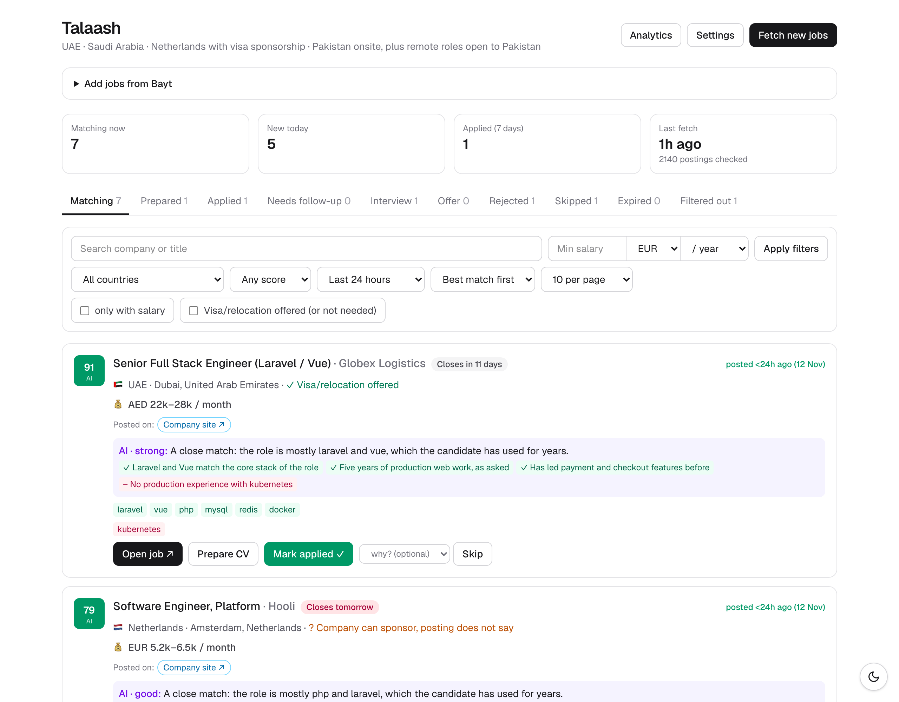
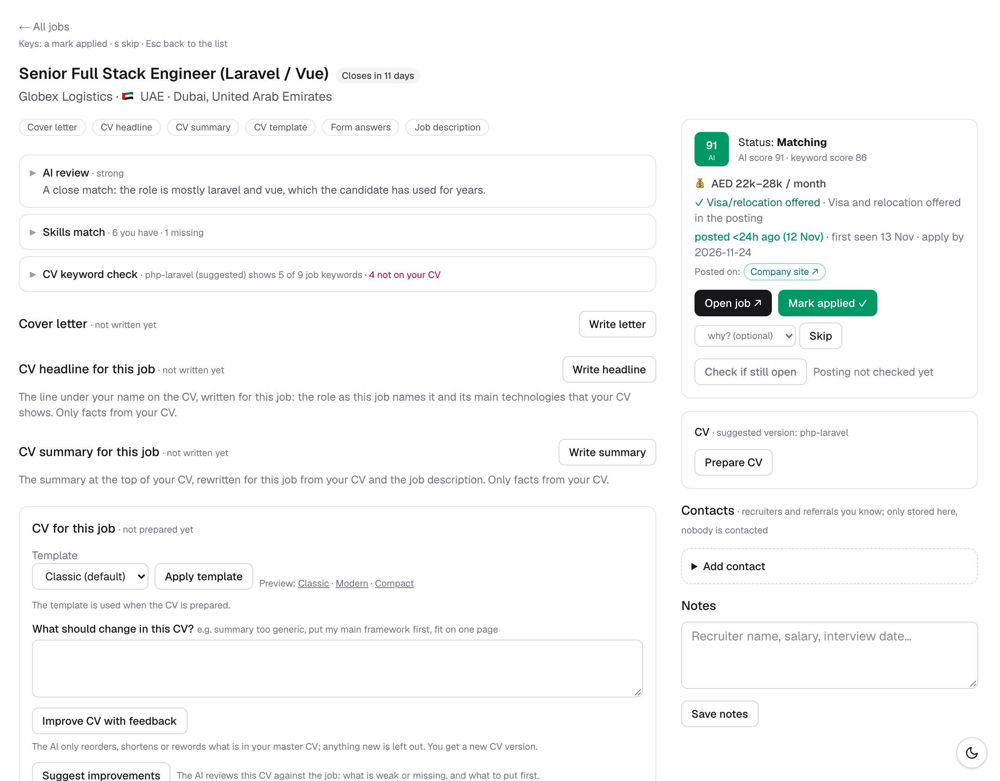
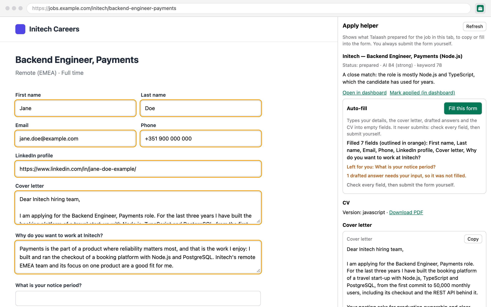
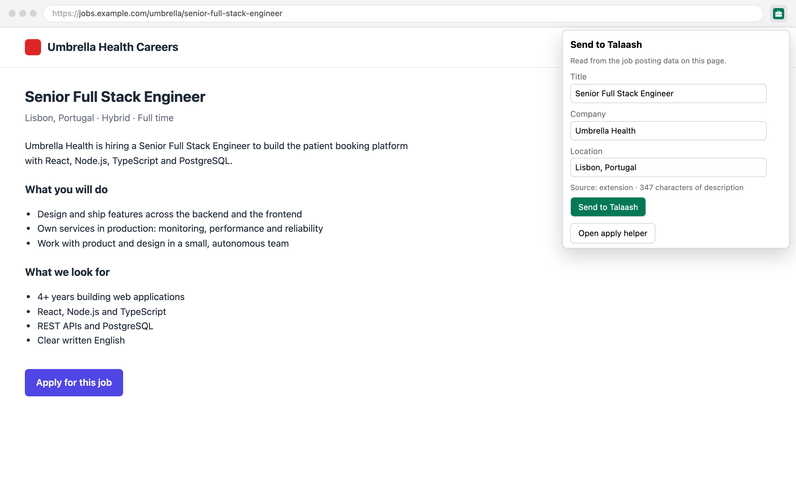

# Daily use

How to work with Talaash once it is installed: the morning routine, the dashboard, applying with the Chrome extension, follow-ups, and the CLI commands you use day to day. The commands are the same on macOS, Linux and Windows.

Back to the [start page](README.md). Every command is in the [CLI reference](cli.md).

Contents:

- [A typical day](#a-typical-day)
- [Starting the dashboard](#starting-the-dashboard)
- [The job list](#the-job-list)
- [A job's page](#a-jobs-page)
- [Applying with the Chrome extension](#applying-with-the-chrome-extension)
- [After you apply: tracking and follow-ups](#after-you-apply-tracking-and-follow-ups)
- [Adding jobs yourself](#adding-jobs-yourself)
- [Settings and Analytics](#settings-and-analytics)
- [CLI commands for every day](#cli-commands-for-every-day)

## A typical day

1. At your daily run time (`dailyTime` in `config.json`, default 09:00, **Daily run time** on the Settings page) the scheduled daily run (`npm run bot -- daily`) fetches new jobs, marks closed postings expired, lets the AI review the new matches, shows a notification with the result and backs up the database. Jobs the AI rates `strong` get a notification of their own.
   Housekeeping on the way: the Dutch IND sponsor register is downloaded again when it is a week old (if a country uses `ind-register`), every step has a time limit so one that hangs cannot block the rest, logs over 5 MB (`data/fetch.log`, `data/logs/tasks.log`, `data/launchd.err.log`) move to `<name>.1`, and each full fetch deletes filtered postings older than twice `maxAgeDays` (at least 30 days) that no fetch has seen for a week and that have no history, contacts or tasks. After the backup a cleanup (5-minute limit) deletes `data/questions` and `data/settings` files older than a day, keeps the newest 20 copies in `data/cv-backups`, and removes `cv/versions/custom-*` folders whose job is skipped, expired or rejected with no status change for 90 days, unless a job with another status still uses that version; it logs what it removed to `data/fetch.log`.
2. Start the dashboard (`npm run web`) and open <http://localhost:3100>. The **Matching** tab has the jobs that passed every filter, best match first.
3. For each job worth it: open it, **Prepare CV**, **Write letter**, check the CV keyword check, and draft answers if the form has questions.
4. Open the posting, apply on the company's site (the extension's **Fill this form** types in what was prepared), and submit it yourself.
5. Mark the job **Applied**. A week later, if there is no news, it appears under **Needs follow-up**.

## Starting the dashboard

```bash
npm run web          # http://localhost:3100
```

Leave the terminal open: the dashboard only runs while `npm run web` runs, and nothing starts it after a reboot. Ctrl+C stops it. It listens on `127.0.0.1` only (not on your Wi-Fi), refuses requests whose Host is not localhost, and has no login, so never expose it.

Heavy work (fetch, prepare, AI review, letters, answers, interview prep, follow-up drafts) runs as a background task: the page shows "Working…" and refreshes when it finishes. A failed task stays on the page with its error until you dismiss it. The output goes to `data/logs/tasks.log`.

## The job list

The home page shows four numbers (matching now, new today, applied in the last 7 days, last fetch), the tabs and the filters.



**Tabs**, one per status: **Matching** (`new`), **Prepared**, **Applied**, **Needs follow-up** (applied jobs with no news for 7 days), **Interview**, **Offer**, **Rejected**, **Skipped**, **Expired** (the posting closed) and **Filtered out** (failed a filter; each shows why). Each tab shows its count.

**Search and filters:**

- **Search company or title** looks in every tab, and each result says which tab it is in. "Search only in _tab_" (or clicking a tab) narrows it to one tab.
- **Country**, **Score ≥ 50 / 60 / 70 / 80**, **Posted within** (24 hours, the default on the Matching tab; 3 days, 7 days or any time). Other tabs never hide a job for its age.
- **Sort:** "Best match first" (the AI score, with the keyword score as a fallback) or "Newest first".
- **Per page:** 10 (default), 25, 50 or 100. Page links above and below the list keep the tab, filters and sort.
- **Min salary** in any currency of `src/currencies.json`, per month or year. It starts in your country's currency (`countryCode` in `cv/applicant.json`, else `remote.fromCode`) and compares in euros per year with fixed, approximate rates. Jobs without a salary stay visible unless "only with salary" is ticked.
- **Visa/relocation offered (or not needed)** keeps only jobs whose posting offers a visa or relocation, and jobs where you need none.

**Filters are remembered** until you change them: a refresh, another tab, a job page and back, or opening the dashboard tomorrow shows the same ones (a cookie in this browser). The search text, the tab and the page are not remembered. When a list is empty because of the filters, it says how many jobs match without them and offers **Show any time** and **Reset filters**; <http://localhost:3100/?reset=1> does the same reset.

**Each card** shows the scores, the AI verdict and reasons, the location with the visa label, the application deadline when the posting states one (**Closes in N days**), the salary (with a "below your expectation" hint when `cv/applicant.json` → `expectedSalary` is higher), every site the same job was found on, matched and missing skills, flags, your notes, and buttons: open the posting, **Prepare CV**, **Download CV**, AI review, and status buttons. **Skip** asks why (stack, seniority, salary, location, company, language, other); `/analytics` shows the patterns.

**Triage from the keyboard:** `j` / `k` (or the arrow keys) move between cards, `Enter` opens the posting, `o` the job page, `a` marks applied, `p` prepares the CV, and `s` jumps to the skip reason (`Enter` skips, `Esc` backs out). `x` or shift-click selects cards for **Skip selected**, which skips them all with one optional reason. Press `?` for the full list. The keys are off while you type in a search box or select. Bulk skip is on the **Matching** and **Prepared** tabs only, at most 100 jobs at once; a job that changed status meanwhile (in another tab, say) is left alone.

## A job's page



Click a job's title. **← All jobs** at the top goes back to the exact list you came from (tab, filters, search, page), and **Previous** / **Next** walk through that list, also after you mark the job applied or skip it. Keys: `j` next, `k` previous, `Esc` back to the list, `a` marks applied, `s` jumps to the skip reason; they are off while you type.

From top to bottom:

- **Check if still open:** asks the job board whether the posting still exists. **Prepare CV** checks this first and stops on a closed posting.
- The full description, the AI review (score, verdict, reasons, gaps, red flags, location check) and the **CV keyword check**: which of the job's skills the CV shows near the top, which you have but this CV keeps further down, and which are not on your CV. Tick **I have this** for a skill you really have (with an optional note for the AI) and **Add to my CV and improve it for this job** adds it to your master CV and revises this job's CV.
- **CV for this job:** the CV version and its template, **Apply template** (classic, modern, compact; previews open in a new tab), **Download CV**, **What should change in this CV?** → **Improve CV with feedback**, and **Suggest improvements** (its suggestions can be copied into the box with **Use as feedback**). See [your-cv-and-profile.md](your-cv-and-profile.md#improving-a-jobs-cv-with-feedback).
- **Cover letter:** **Write letter**, **Rewrite letter**, **Copy**, **Download PDF**, **What should change?** → **Rewrite with feedback**, and **Edit** / **Save** to change it yourself. Above an AI letter, a note says what the letter check fixed (claims your CV or the posting does not support); read the letter once more before you send it.
- **CV summary for this job:** **Write summary**, then **Rewrite summary**, **Copy**, and **Use in my CV for this job**, which builds a one-off CV with it so **Download CV** serves that one.
- **Form answers:** paste the questions from the application form and **Draft answers**. The AI answers from your CV and profile only; personal decisions it cannot know (salary, notice period, start date) come back as `[FILL: ...]`, highlighted. Each answer has a **Copy** button.
- **Interview prep** (applied and interview jobs): likely technical questions, behavioural questions with STAR stories from your CV, a short company brief from the posting alone (unsure points are marked "verify before interview"), questions to ask, and the requirements mapped to your CV. **Regenerate** writes it again.
- **Your history with the company:** the other jobs at this company you prepared, applied to or skipped, with their status (and skip reason), and how many more wait in Matching. **Never show this company** hides it: its waiting and new jobs move to Filtered out, and Settings, **Companies to hide**, takes it back.
- **Contacts:** recruiters, hiring managers and referrals for this job, plus people you know at the same company, with an "ask for a referral before applying" reminder on jobs you have not applied to.
- Notes and the status history. **Undo** under History moves the job back along its last status change (an `applied` date or a skip reason is restored); an undo cannot itself be undone, and `/analytics` ignores an undone change (it counts real status changes only, not follow-up notes). A status button in an old browser tab whose job has moved on (to Interview, say) is refused with a message instead of moving it back.

Rewriting a letter, CV summary or headline you edited by hand asks first, since the edit would be lost; so does **Clear all** for drafted answers.

## Applying with the Chrome extension

With the dashboard running and the extension loaded (see your install guide):



1. Open the job's posting and click the Talaash button. If the job is not in Talaash yet, **Send to Talaash** adds it (it goes through the same filters and scoring as fetched jobs).
2. Open the **Apply helper** side panel: it shows the job's status, scores, the prepared CV (download link), the cover letter and the drafted answers, each with **Copy**.
3. On the application form, click **Fill this form**. It types your name, email, phone, LinkedIn and location, the cover letter, matching drafted answers and the CV PDF into the form's **empty** fields (outlined in orange), also inside embedded Greenhouse or Workday forms. It never overwrites what you typed, never fills `[FILL: ...]` answers, passwords, checkboxes or radios, and never clicks a button or submits.
   Custom dropdowns, listboxes, radio groups and Yes/No buttons are never typed into: empty ones are listed under **Left for you** as "pick from the list". The panel also works on the application page itself (Lever `/apply`, Ashby `/application`, Workday's steps) and remembers the job through a multi-step form. On a form whose job is not in Talaash, **Fill profile + CV only** types just your contact details and default CV. If the dashboard runs on another port than 3100, set it in the extension's options.
4. Check everything, fill in the rest, and submit it yourself.
5. **Mark applied (in dashboard)** opens the job on the dashboard, where you mark it **Applied**.



Details: [extension/README.md](https://github.com/abdulrehmandar2234/talaash/blob/main/extension/README.md).

## After you apply: tracking and follow-ups

Statuses go `new` → `prepared` → `applied` → `interview` → `offer` / `rejected`, plus `skipped`, `expired` and `filtered`. Every change is logged with an optional note.

An `applied` job with no news for 7 days shows a "Follow up · N days" badge and appears under **Needs follow-up**. On its page, **Draft follow-up** has the AI write a short message (addressed to the job's recruiter or hiring-manager contact if you added one; a template when the AI is off). You send it yourself, then click **I sent a follow-up**: the reminder waits another 7 days, and stops after 2 follow-ups.

## Adding jobs yourself

- **Chrome extension:** "Send to Talaash" from any job page (above).
- **Bayt bookmarklet:** Bayt blocks direct requests, so the dashboard's home page has an "Add jobs from Bayt" section with a bookmarklet you drag to the bookmarks bar and click on bayt.com.
- **By hand:** `npm run bot -- add --file job.json` with a JSON object (or the same JSON on stdin):

  ```json
  { "source": "referral", "company": "Example Ltd", "title": "Senior Full Stack Engineer", "location": "Amsterdam, Netherlands", "url": "https://example.com/jobs/123", "description": "full job text" }
  ```

- **A company's whole board:** `npm run bot -- discover "Example Ltd" --add` finds it on the supported ATS platforms and adds it to `config.json` → `companies`.

## Settings and Analytics

- **Settings** (`/settings`): your profile, the cover-letter sentences, form facts, the search and filter settings, the CV template and the AI provider, validated with the same schemas as the CLI before they are saved. After changing filters, run `npm run bot -- rescore`.
- **Analytics** (`/analytics`): the application funnel, response rates per source, country, CV version and AI verdict, weekly activity, time to a reply, the skills radar (the skills matching jobs of the last 90 days ask for most, split into those your CV shows and those it does not), skip patterns and fetch health (recent fetches and the sources that failed).

## CLI commands for every day

Run them in the project folder. `<id>` is a job's id, shown by `list` and in the dashboard's URL.

```bash
npm run bot -- fetch                       # fetch now (or "Fetch new jobs" on the dashboard)
npm run bot -- fetch --company linkedin    # only the sources whose name contains "linkedin"
npm run bot -- ai:score                    # AI review of new matches (--all: review every match again)
npm run bot -- ai:score --location-filtered  # re-check jobs an earlier review filtered for location
npm run bot -- rescore                     # re-apply the filters after editing config.json, no downloads
npm run bot -- stats                       # job counts per status and country
npm run bot -- list                        # best new matches (--status, --country, --min, --limit)
npm run bot -- list --status filtered      # what was filtered, and why
npm run bot -- show <id> --full            # one job with its full description
npm run bot -- prepare <id>                # CV for the job (checks the posting is still open; --letter also writes the letter)
npm run bot -- letter <id>                 # write the cover letter (--feedback "..." to rewrite it)
npm run bot -- answer <id> --file q.txt    # draft answers to the questions in q.txt (--clear to reset)
npm run bot -- mark <id> applied "via the company site"   # or interview, offer, rejected, skipped, expired
npm run bot -- mark <id> skipped --reason salary
npm run bot -- follow-ups                  # applied jobs due a follow-up
npm run bot -- follow-up <id>              # draft a follow-up message
npm run bot -- followed-up <id>            # record that you sent it
npm run bot -- check:open                  # mark closed postings expired
npm run bot -- cv:default                  # rebuild your CV PDF after editing cv/master.json
npm run bot -- daily                       # the whole morning run, by hand
npm run bot -- backup                      # a database backup now (data/backups/, keeps 14)
npm run bot                                # list every command
```
