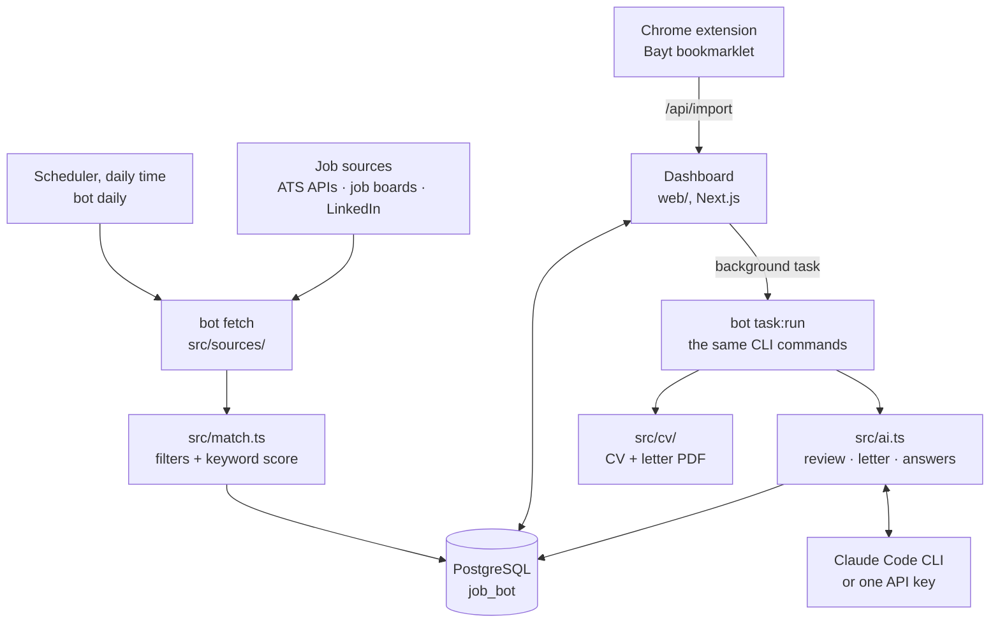

# How it works

How the pieces fit together: the two programs, the path of one job from a source to your application, the CV pipeline, the database and the code layout. The AI providers, presets and which model does what are on the [AI page](ai.md).

## Architecture



Sources are the company boards (Greenhouse, Lever, Ashby, Recruitee, Workable, SmartRecruiters, Workday, Personio), the job boards (Himalayas, Remotive, RemoteOK, Arbeitnow, Adzuna, Jobicy, Hacker News "Who is hiring", freehire.me) and LinkedIn's guest search; [Features](features.md#sources-at-a-glance) lists them. After every command that adds jobs or changes a status, `dedupe()` (`src/db.ts`) groups copies of the same job under one primary row. CV and letter PDFs are rendered by Chrome's headless shell (playwright-core).

The project has two parts that share one PostgreSQL database:

1. **The bot CLI** (`src/`) does all the real work: fetching, scoring, AI calls and CV rendering. Node 24+ runs the TypeScript directly, so there is no build step.
2. **The dashboard** (`web/`, Next.js) reads the database directly for display. For anything heavy (fetch, prepare, AI review, form answers, interview prep, follow-up drafts) its server actions queue a background task and return at once: they insert a row in `tasks` and start a detached `bot task:run <id>` (`web/lib/bot.ts` `spawnBot`, argument array, no shell, output in `data/logs/tasks.log`). That worker claims the row, runs the normal CLI command and stores the result, so the CLI and the dashboard always behave the same. The page shows "Working…" while a task runs, polls `/api/tasks` and refreshes when it finishes; failures stay on the page with their error until dismissed. Only one fetch, and one task per kind and job, runs at a time, and a task whose worker died is failed so it never blocks new ones: at once when its worker pid no longer exists, otherwise after its timeout (Mac slept or restarted). Finished tasks are deleted after 30 days (`src/task-queue.ts`, `KEEP_FINISHED_DAYS` in `src/types.ts`).

## A job's journey

1. **Fetch.** `bot fetch` loads every source, four at a time. Each adapter in `src/sources/` turns the API response into a common `RawJob` (id, company, title, location, url, description, posted date). Requests use a shared paced `sleep` (`src/sources/http.ts`).
2. **Score.** Every job goes through `scoreJob()` in `src/match.ts`. It first drops companies you hid (`blockedCompanies`), then detects the country, applies the filters, computes the keyword score and picks a CV cluster. The result is upserted into `jobs` with status `new` or `filtered` (+ reason).
3. **Group.** `dedupe()` links copies of the same job (normalized company + title + country, letters of any script) to one primary row, preferring the company's own site or the copy you already worked on.
4. **AI review.** `bot ai:score` sends each new match plus your CV to the AI provider with a JSON schema and stores the score, verdict, reasons, gaps, flags and the location check (a `no` moves the job to `filtered`). `ai:score --all` reviews every matching job again.
5. **Prepare.** `bot prepare <id>` picks the CV version (default, or `--cv <cluster>`), renders the PDF if that version does not exist yet, and sets the status to `prepared`. It writes no cover letter: `bot letter <id>` ("Write letter" on the job page) does that on request, or `prepare --letter` for both at once. A second AI call then checks an AI letter against your CV and the posting and fixes unsupported claims (`ai.checkLetters`).
6. **Answer.** `bot answer <id>` drafts application-form answers and stores them on the job.
7. **Apply (you).** You open the posting, upload the CV, paste the letter and answers, submit, then mark the job `applied`.

## CV pipeline

```
cv/master.json                       your CV data (the only file you edit)
src/cv/profiles.ts                   per-cluster framing: headline, summary, skill/bullet order
src/cv/versions.ts                   builds and reuses versions, bumps v2/v3 on change
src/cv/render.ts                     HTML template → PDF via Chrome (playwright-core; src/cv/chrome.ts picks which)
src/cv/templates/                    the CV designs: classic.ts, modern.ts, compact.ts, index.ts (list and names)
src/cv/feedback.ts                   keeps a CV revised with feedback to master CV content

cv/original/<your original CV>.pdf  optional, never changes
cv/default/<cvFileName>
cv/versions/<cluster>-v<N>/<cvFileName>
cv/versions/<cluster>-<template>-v<N>/<cvFileName>   the same in another template (modern, compact); cluster may be "default"
cv/versions/custom-<company-role>-v<N>/<cvFileName>   one-off CV for one job (custom, cv:tailor, cv:feedback, cv:template), new N per run
```

Each version folder has `cv.json` (the data it was rendered from) and `meta.json` (cluster, template, master hash, the job for one-off versions, and for a CV revised with feedback what was left out). Versions made before templates existed have no template and are classic.

`cvFileName` is set in `config.json` (e.g. `jane_doe_resume.pdf`). The per-cluster framings in `src/cv/profiles.ts` (headline and summary per stack) are written for the original author's CV; with your own CV, keep `autoCvVersions: false` and send the default CV until you have rewritten them for yourself (`tests/cv.test.ts` checks a framing never claims more than `cv/master.json`).

`config.json` → `"autoCvVersions": false` means every job gets the default CV unless you pick a version. Edit `cv/master.json`, then run `bot cv:default` (default CV) or `bot cv:build` (all versions).

## Database

Every CLI command that uses the database first applies the numbered SQL files in `src/migrations/` that the database has not run yet (recorded in `schema_migrations`), and the dashboard applies them when it starts (`web/instrumentation.ts` runs `npm run bot -- migrate`; a failure is logged and the dashboard still starts). `npm run bot -- migrate` applies them on its own. To change the schema, add the next `NNN_name.sql` file; never edit one that is already committed (see `src/migrate.ts`).

- `jobs`: one row per posting. It holds the score, matched/missing skills, visa note, flags, status, filter reason, CV version, the CV template chosen for the job, the AI review of its CV, cover letter, CV headline and summary for the job, when you last edited either by hand, AI review, form answers, interview prep, follow-up count and draft, alert time, notes, the application deadline the posting states and `duplicate_of`.
- `job_events`: every status change with a note.
- `fetch_runs`: per fetch, how many postings were checked, how many were new and which sources failed.
- `tasks`: the dashboard's background tasks (see [Architecture](#architecture)).
- `contacts`: people per job and company.

Connection: `DATABASE_URL` in `.env` (the bot) and `web/.env.local` (the dashboard), e.g. `postgres://postgres@127.0.0.1:5432/job_bot`, on a local PostgreSQL 15 or newer (DBngin or Homebrew on macOS, the distribution package on Linux, the EDB installer on Windows).

## Project structure

```
src/
  cli.ts            command entry point: flags, command registry, dedupe after changes
  commands/         one file per command (or small group of related commands)
  config.ts         loads config.json
  settings.ts       zod schemas for config.json and cv/applicant.json, settings file paths
  presets.ts        market and stack presets (presets/) for the setup wizard
  regions.ts        remote-from country to remote region allow / deny / flag patterns
  errors.ts         UserError (printed without a stack trace) and ConfigError
  types.ts          row types shared with the dashboard
  match.ts          filters, keyword score, CV cluster
  deadline.ts       the application deadline a posting states, and days left
  posting-guard.ts  hidden text and invisible characters out of postings, the flag for text aimed at AI tools
  salary.ts         salary range extraction
  ind-salary.ts     the Dutch IND highly-skilled-migrant salary minimum and the flag for Dutch jobs below it
  currencies.ts     country → currency table (currencies.json), marks and approximate rates
  ats.ts            CV keyword check (shown / hidden but true / missing)
  db.ts             Postgres access, upsert, status changes, dedupe
  migrate.ts        migration runner (applied on start)
  migrations/       numbered schema files (001_baseline.sql, ...)
  ai.ts             AI prompts and schemas: review, letter, letter check, CV summary, form answers, interview prep, follow-up, CV import
  ai-providers.ts   AI providers: Claude CLI or one API key (askAi)
  ai-presets.ts     API presets: URLs, default models, JSON mode, key detection
  profile.ts        your profile from cv/applicant.json (+ cv/master.json fallbacks), visa and remote-from rules
  task-queue.ts     task queue rules shared with the dashboard (enqueue, dead workers, pruning; takes the pool)
  tasks.ts          the bot's side of the queue (claim, run, time out, CLI arguments per kind)
  notify.ts         desktop notifications per OS (macOS, Linux, Windows) for strong matches and the daily run
  backup.ts         pg_dump + gzip of the database, keeping 14; restore of a backup with psql
  cleanup.ts        daily cleanup: temp files, old cv-backups, one-off CVs of finished jobs
  followup.ts       follow-up reminders and template
  contacts.ts       contact and referral rules shared with the dashboard, company keys and hidden companies
  cover.ts          template cover letter
  sponsors.ts       IND recognised-sponsor register
  discover.ts       find a company's ATS board
  sources/          ATS adapters, job boards, LinkedIn, dead-link check, paced and cached HTTP
  cv/               profiles, versioning, PDF rendering, templates/ (CV designs), feedback.ts (master-CV check), import.ts (reading a CV file for cv:import)
web/
  app/              pages, server actions, API routes
  components/       UI and client components
  lib/              DB queries, the CLI runner, settings readers; the bot's rules are imported from src/
  proxy.ts          refuses requests whose Host is not localhost
scripts/            launchd wrapper (daily-fetch.sh), test launcher, test-database creation, Bayt bookmarklet
docs/               README.md (start here), install/{macos,linux,windows}.md, configuration, CV and profile, AI, daily use, troubleshooting, updating
extension/          Chrome extension: send a job, apply helper side panel with form auto-fill
tests/              backend tests (node:test)
web/tests/          dashboard tests (vitest)
```

## Tech stack

- Node 24+ running TypeScript directly (ESM, no build step)
- PostgreSQL via `pg`, shared by the bot and the dashboard
- Next.js 16 + Tailwind (`web/`)
- `playwright-core` with Chrome's headless shell (or a system Chrome) for CV PDFs
- Claude Code CLI (default) or any OpenAI-compatible API for AI features
- node:test and Vitest + Testing Library for tests

## Tests

```bash
npm test             # backend: matching, sources, dedupe, CV, AI, DB, CLI (node:test)
npm run test:web     # dashboard: components, DB queries, API routes, server actions (vitest)
npm run test:all     # both
npm run typecheck    # tsc for the bot (src/, tests/) and the dashboard (web/)
npm run lint         # Biome lint + format check; npm run format fixes it
```

- Tests use separate databases: `job_bot_test_bot` (backend) and `job_bot_test` (dashboard). They never touch the real `job_bot`. Create them once with `npm run test:db -- job_bot_test_bot job_bot_test` (the script needs the names). `BOT_TEST_DB` / `WEB_TEST_DB` pick other test databases (e.g. `job_bot_test_bot_wt1`) so parallel worktrees do not collide.
- Some tests pin the original author's letters and filter results against `config.default.json` and the repository's `cv/master.json` (`tests/fixtures/owner-golden.json`), so they fail once you replace `cv/master.json` with your own. Tests never read your `config.json`: they use a temporary copy of `config.default.json` (`tests/helpers.ts`, `web/tests/setup.ts`).
- Job-site requests are mocked, a fake script (`tests/fixtures/fake-claude.mjs`) stands in for Claude, and the API providers answer from mocked fetch with a dummy key, so tests run offline and use none of your Claude plan or API credit.
- Every new feature or change ships with its tests (see `CLAUDE.md`).
- `npm install` points git at `.githooks/`, so each commit runs Biome on the staged files. GitHub Actions runs on every pull request and on pushes to main (plus once a month): lint, typecheck, both suites, a build of the dashboard and a coverage summary (informational, never fails the run) on Ubuntu, and typecheck and the tests that need no database on Windows with Node 24 and 26.
- The npm scripts use no shell syntax, so they run in PowerShell and cmd.exe too: `npm test -- tests/match.test.ts` runs one file on any OS (`scripts/run-tests.mjs` sets `DATABASE_URL`).
