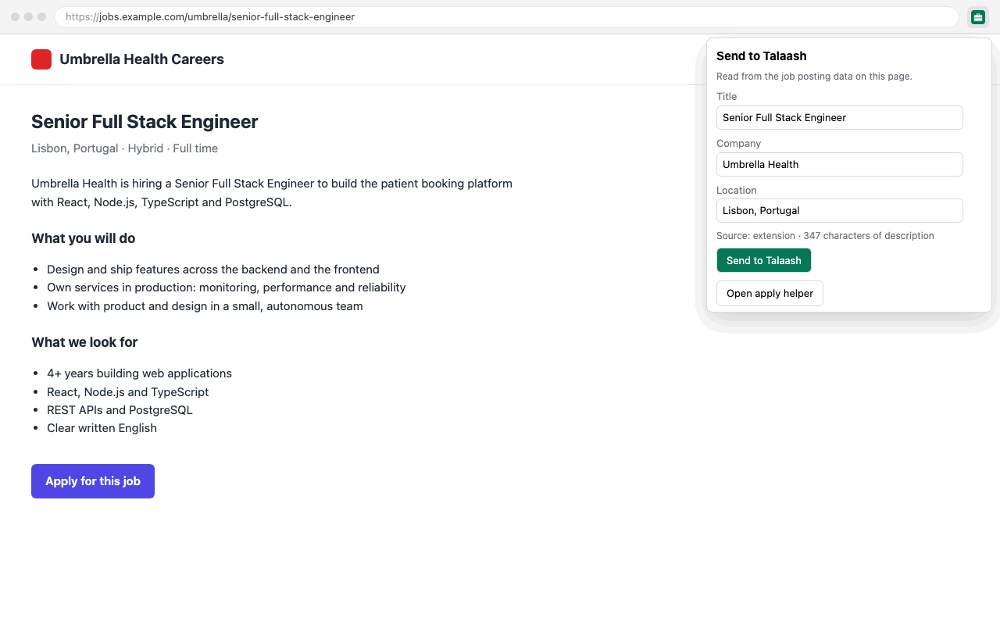

# Talaash Chrome extension

Sends the job you are looking at to your local Talaash, and shows what Talaash prepared for it (CV, cover letter, form answers) so you can copy it, or fill it into the application form, while you apply. It replaces the Bayt bookmarklet as the main way to add jobs from the browser. The bookmarklet still works.

The day-to-day flow is in [docs/daily-use.md](../docs/daily-use.md#applying-with-the-chrome-extension); installing it is step 14 of each [install guide](../docs/README.md), and problems with the Bayt bookmarklet's import token are in [docs/troubleshooting.md](../docs/troubleshooting.md#missing-or-wrong-import-token-bayt-bookmarklet).



## What it does

- **Send to Talaash** (toolbar button). When you click it, the popup reads the job from the open tab:
  - first from the page's schema.org `JobPosting` data (title, company, location, remote, description, date posted, url), which most job boards and career sites include;
  - else from the page title ("Job Application for <title> at <company>" on Greenhouse keeps a hyphen inside the title), a short location element on the page, plus the text you selected (or the page's main text). Select the job description before clicking to send only that. Check the fields before sending.

  You can fix the title, company and location, then press **Send to Talaash**. The dashboard runs it through `bot add` (same filters and scoring as fetched jobs) and the popup shows the result: added with its score, filtered with the reason, or already in Talaash.
- **Apply helper** (side panel, opened from the popup). For the job in the active tab it shows the status, the scores and AI verdict, a link to download the prepared CV, the cover letter and every drafted form answer, each with a **Copy** button. It follows you when you switch tabs: while the panel is open, the active tab's URL is looked up against your local dashboard to find a matching job — on every site you visit, not only job boards. The URL goes only to your local dashboard (`http://localhost:3100` unless you changed it in the options). **Open in dashboard** and **Mark applied (in dashboard)** open the job's page on the dashboard, where you record the application. If the job is not in Talaash yet, the panel offers **Read this page** and the same send form (Chrome asks once per site to let the panel read pages there).
  - **Application pages.** Lever (`…/apply`), Ashby (`…/application`), Greenhouse (`#app`) and Workday (`…/apply`, `…/apply/applyManually` and other apply steps) keep the application form at another URL than the posting. The dashboard takes that step off a known ATS URL and finds the posting, so the panel shows the job and **Fill this form** there too. The rule is per ATS host: an `/apply` page on any other site is not matched to anything.
  - **Multi-step forms.** The panel remembers which job a tab is applying for (in `chrome.storage.session`, memory only, gone when Chrome closes), together with the last "Filled N / Left for you" result. When a step of the form changes the URL, the panel keeps showing that job and that result. The memory holds while the tab stays on the job's host, under the posting's path, with no other job id; it is dropped when the tab goes anywhere else (another site, another company or job on the same ATS host such as `jobs.lever.co`) or closes.
- **Fill profile + CV only** (side panel, on a page whose job is not in Talaash). Types just your name, contact details and location, and your original CV (`cv/default`), into empty fields: no cover letter and no drafted answers, since those belong to one job. Same rules as **Fill this form**: only on your click, only empty fields, never submits.
- **Fill this form** (side panel). Types into the form's **empty** fields, in the page and in its iframes (Greenhouse and Workday embed their forms):
  - your name (first, last or full), email, phone, LinkedIn and location, from `cv/master.json` (`cv/applicant.json` `currentLocation` wins for the location);
  - the cover letter, into a "Cover letter" text box;
  - drafted form answers, into the field whose label matches the question (selects pick the matching option);
  - the prepared CV PDF, into a "Resume" / "CV" file input.

  Filled fields get an orange outline. The panel lists what it filled and what it left for you. Custom dropdowns are listed under **Left for you** as "pick from the list", never typed into: autocomplete inputs (`role=combobox` / `aria-autocomplete`, the react-select boxes on Greenhouse and Ashby), and, when they are required (`aria-required`, or a `*` / "required" on their label) and unanswered, Workday's button dropdowns, ARIA listboxes and radio groups, and Ashby's Yes/No buttons. Typing text into an autocomplete box would look filled while no option is chosen. Chrome asks once per site to let the panel work there; when the form is an iframe from another site (a careers page embedding Greenhouse), the panel shows an **Allow <site> and fill** button for that site too.

## What it does not do

- It never clicks a button, ticks a checkbox or radio, or submits a form, and never logs in anywhere. You check the filled form and submit every application yourself.
- It never overwrites a field that already has a value, and never fills answers that need your input (`[FILL: ...]`), passwords, checkboxes or radios.
- It never fills hidden fields: a field hidden with `display:none`, `visibility:hidden`, near-zero opacity, zero size or an off-screen position is skipped, so a page cannot harvest your details through invisible inputs. The one exception is a CV file input hidden behind a visible "Upload" label, the usual styled-upload pattern.
- It fills plain inputs, textareas, selects and file inputs only. Rich-text boxes (`contenteditable`) and custom dropdowns — autocomplete boxes, much of Workday's own UI, Yes/No buttons — are not filled, by design: choosing an option means clicking, which it never does. They are listed for you instead (see above).
- It types values in through normal `input`/`change` events, so the page's own scripts see them and may react on their own (validate, or auto-advance a step, as some ATS widgets do). The extension itself never clicks or submits, but what the page's own handlers do with a change is outside its control.
- It only types into a page when you click **Fill this form**.
- It does not run in the background or read pages you do not click it on.
- It talks only to your local dashboard (`http://localhost:3100`, or the localhost address you set in the options). Nothing is sent anywhere else.

## Install (unpacked)

1. Start the dashboard: `npm run web` in the Talaash folder (it must be running at http://localhost:3100).
2. Open `chrome://extensions` in Chrome.
3. Turn on **Developer mode** (top right).
4. Click **Load unpacked** and choose this `extension/` folder.
5. Pin the Talaash button to the toolbar (puzzle icon → pin).

After pulling changes, press the reload icon on the extension's card in `chrome://extensions`.

If the dashboard is not running, the popup and the side panel say so; start it and try again.

### Dashboard address (options)

The extension expects the dashboard at `http://localhost:3100`. If yours runs on another port, open the extension's options (**Extension options** in the popup or panel, or **Details → Extension options** in `chrome://extensions`), enter the address (`http://localhost:3200`, `127.0.0.1:3200` or just `3200`) and press **Save**; **Check connection** tests it. Only `localhost` and `127.0.0.1` are accepted, with no path. The address is kept in `chrome.storage.sync`.

Every answer from `/api/jobs/lookup` carries `app: 'job-bot'`. When something answers on the address without it (another app on that port), the popup and the panel say "Something else is answering on <address> — check the dashboard port in the extension options" instead of a misleading error code.

No host permission is needed for any dashboard address: the dashboard answers the extension through CORS for its pinned id (see below), so the extension never asks for one.

## How the dashboard trusts it

`/api/import` and `/api/jobs/lookup` accept only requests whose `Origin` is this extension, and `/api/cv/<version>` lets only this extension read the PDF cross-origin: `chrome-extension://fmkmpckdcfhibobdiffankccildkcnij`. Web pages cannot forge the `Origin` header, so other sites cannot add jobs or read your letters. Other extensions you have installed are refused too.

The id is pinned by the public key in `manifest.json` (`"key"`): Chrome derives an unpacked extension's id from it, so every install gets the same id. The private key is not needed for loading unpacked and is not stored anywhere. If you replace the key, compute the new id (sha256 of the decoded key, first 32 hex digits mapped `0-f` → `a-p`, or read it on the extension's card in `chrome://extensions`) and set it for the dashboard in `web/.env.local`:

```
JOB_BOT_EXTENSION_ID=<new id>
```

Then restart the dashboard. The extension deliberately has no host permission for `localhost:3100`: with one, Chrome leaves out `Origin` on GET requests, and the lookup route would refuse them.

Permissions: `activeTab` + `scripting` (read the tab you clicked the button on, and fill its form when you ask), `tabs` (the side panel needs the active tab's url), `sidePanel`, `clipboardWrite` (Copy buttons), `storage` (the dashboard address, and the tab → job memory for multi-step forms). Reading pages from the side panel uses optional per-site permissions that Chrome asks you for.

## Files

- `manifest.json`: Manifest V3.
- `popup.html`, `popup.js`: the toolbar popup.
- `options.html`, `options.js`: the options page (dashboard address).
- `panel.html`, `panel.js`: the Apply helper side panel.
- `send.js`, `dom.js`, `style.css`: the shared send form and UI helpers.
- `lib/`: plain ES modules with no `chrome.*` calls, tested by `tests/extension.test.ts` (and `web/tests/extension/` for the page side):
  - `collect.js` reads the page (runs inside the tab, read-only),
  - `jobposting.js` turns JSON-LD or page text into a job,
  - `text.js` HTML to text and cleanup, `url.js` URL normalization, the application-step → posting URL (`postingUrl`, same rules as the dashboard's) and the hostname → source name,
  - `fill.js` plans the auto-fill (which empty field gets which value),
  - `page-fill.js` runs in the page: lists the form fields and types the planned values (never submits),
  - `api.js` the calls to the dashboard (job lookup, CV download) and the result messages,
  - `settings.js` the dashboard address (checked to be localhost, stored in `chrome.storage.sync`),
  - `tab-memory.js` the tab → job memory for multi-step forms (`chrome.storage.session`, passed in).
- `icons/`: PNG icons, drawn by `node extension/icons/make-icons.mjs`.
